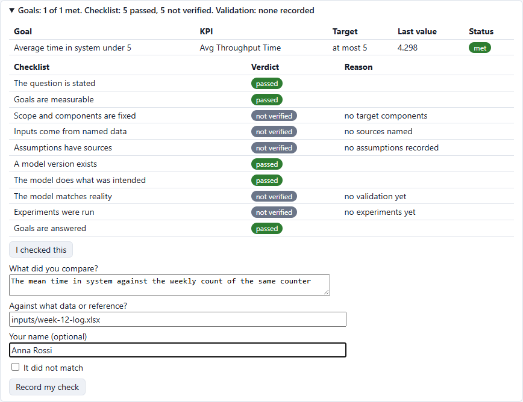

# Run a study with an assistant

The engine can keep a whole simulation study in a folder and test every model step, so any
assistant that speaks to it (see [Use with an agent](mcp.md)) can run a study without remembering
anything between calls. The folder is the memory: each call names it, reads it and writes it back.
That makes a study resumable by a different assistant, or by you, the next day.

## What a study folder holds

A study folder is an ordinary folder under the workspace root, and its id is its path relative to
that root. It holds the question and the decision behind it, the goals with the KPI ranges that
would meet them, the assumptions and their sources, the plan and whether the person approved it,
the validation done, and every model version with its checks and report. Inputs the person
supplies (a spreadsheet, a transcript) are kept under `inputs/`.

A goal is a KPI with a range, such as the average queue at most 2. A goal can also bound a tail,
because averages hide the long waits: `{"kpi": "Total Wait", "share_above": 20, "high": 0.1}` asks
that at most 10% of entities wait more than 20 in total over all queues. A study turns on what such
a goal needs for its own runs only.

## The three calls

Three calls are enough to run a study; an assistant makes them in this order and repeats the last two.

- `study_start` takes the decision question, makes the folder and answers with a plan card and the next step.
- `study_status` shows where the study stands on one screen: the goals, the checklist, the last version's KPIs and the next step.
- `study_step` takes the model and a one-line note, runs and checks it, and stores it as a new version. The model is the whole file (`layout`), a model open in the workspace (`model`) or a list of changes to the last version (`patch`).

A step whose model does not validate or run is stored as a draft with its problems, not refused,
so the assistant reads them, fixes the model and steps again. Every answer ends with a `next_step`,
which is all the assistant needs to follow. The other tools keep the record:

- `study_update` records what was learned or decided: goals, assumptions, sources, the approved plan, and the assistant's own note of a validation (which counts as reported, not checked: see below).
- `study_validate` checks the last version against a textbook answer when the model is a single queue, and records the result as checked by the engine.
- `study_add_input` keeps a source file or a piece of text under `inputs/`.
- `study_revert` goes back to an earlier version, recorded as a new version so no history is lost.
- `study_accept` records that the person accepts the study as it stands.

## Seeing the model

Every version keeps a flowchart of its model, so the person and the assistant can see what each step
built. Blocks added or changed in that step have an orange outline, and parts of the agreed target that
have no blocks yet are drawn dashed to the right. The flowchart is stored beside the version as
`flowchart.svg` and as `flowchart.txt`, a plain list of the blocks and links. `study_view` returns it
to the assistant as a PNG image over MCP (with `nagasim[plot]` installed), as SVG, or as that text,
which is what an assistant without image support reads. Looking at the drawing is often the quickest
way to catch a wrong link.

## How many replications

The engine chooses the number of replications from the study's precision target, so the count is a
stated decision rather than a guess. Every goal KPI should reach a 95% confidence half-width of 10% of
its mean in a quick study, 5% in a standard one and 2% in a deep one (or a target the person sets). A step
runs 10 replications, works out from their spread how many each goal KPI needs, and reruns with the
largest count and the same seed, up to 50, 200 or 1000. When the cap stops it first, the step says so and
the precision check is partial, never passed. Each step's answer, the control room and the report state
the count, the target and the precision reached.

## Options against the Baseline

The alternatives are [scenarios](glossary.md#scenario) in the model file. The model as it stands is
the Baseline. Every step runs each scenario with the same replications and seeds as the Baseline, so
each option is paired with the Baseline run by run ([common random numbers](glossary.md#common-random-numbers)).
For each goal KPI, the step's answer gives under `scenarios`:

- the option's mean and [half-width](glossary.md#half-width);
- whether each goal is met;
- `diff_vs_baseline`, the [paired difference](glossary.md#paired-difference) from the Baseline: its
  `mean`, the 95% interval from `lo` to `hi`, and the number of pairs `n`.

The pages turn the paired difference into one sentence:

- "a difference of -3.38 (95% interval -3.82 to -2.93)" when the interval leaves out zero (the
  second server's effect on the queue in the example at the end of this page);
- "no clear difference" when the interval holds zero, so neither option is called better;
- a share's difference in percentage points ("+22.2 points"): a share KPI, such as a tail goal's
  `Share waiting over 15`, is stored as a fraction and shown as a percentage.

A paired interval is usually much narrower than the two options' own intervals side by side. So it can
tell options apart whose own intervals overlap. Sometimes an option also makes a goal KPI markedly
steadier from run to run: a variance test on the pairs is significant at 5%, and the option would reach
the same precision with at most half the replications. Then the write-up, the client page and the room's
goals add one modest line saying so. That line is a statistical observation, not a cause, and it never
reaches the headline. Once an option is recommended, the room's goal chips and the client page's goals
table show that option's value and verdict, with the Baseline beside it. The answer to the person is the
option that meets the goals with a clear difference.

## Who checks the model

Validation (checking that the model matches the real system) passes only when the engine or the
person did it, never on the assistant's word. Each validation entry records who made it, from the way
it came in:

- **engine**: `study_validate` compared a single queue with its textbook formula (M/M/c or M/G/1);
- **person**: the person recorded their own check, with what they compared and against what;
- **assistant**: the assistant recorded a comparison with `study_update`; it reads "reported, not checked".

The checklist item "The model matches reality" is then in one of five states:

- **checked**: an engine or person entry passed, so the item passes;
- **failed**: an entry did not pass;
- **reported**: only the assistant has reported a pass, so the item stays open;
- **earlier**: the person checked a version whose blocks or links have changed since;
- **none**: nothing is recorded.

A reported validation comes with a re-check offer. Where the queue formula applies, the offer is the
`study_validate` call (the room's Re-validate button). Otherwise it is the person's own check. A
person's check names who, when, what and against what on every page. It holds while the model's blocks
and links stay the same: a changed parameter keeps it, and a new block or link asks for it again.

Only the person can record their own check, in one of two ways, and no assistant tool can write or change it:

- the **I checked this** form in the live control room (`naga room FOLDER`, or `naga mcp --room`);
- `naga study confirm FOLDER --text WHAT --against SOURCE [--by NAME] [--failed]` on the command line.



The assistant's part is to show the person what to compare and ask them to record it. So the checklist's
validation item closes on the engine's check or the person's, never on the assistant's alone.

## What each version makes, and what is on request

Each version makes only what the person needs to follow the study: a short summary of what changed,
the goal KPIs with their intervals, the flowchart and the refreshed control room. Heavier output is made
when someone asks for it, from the stored versions, so each step stays quick and the conversation short:

- `study_report`: a version's full run report;
- `study_view`: a PNG of the flowchart;
- `study_animation`: a GIF of the model running (needs `nagasim[plot]`);
- `study_sensitivity`: which assumptions change the answer, each varied 20% either way with common random
  numbers, ranked by how much it moves each goal KPI;
- `study_extensions`: candidate modules (shifts with a break, resource failures, an arrival peak), offered
  only when the engine has tried them on the model and they validate and run; the assistant reviews the
  changed model and steps it;
- `study_writeup`: a paper-style report (HTML and Markdown) with the headings of the STRESS guidelines;
- `study_slides`: a deck for the decision meeting, one 16:9 slide per page when printed
  (`naga study deck FOLDER` prints it as a PDF with your Chrome or Edge);
- `study_package`: the deliverable folder with the page, the workbook, the model, the write-up and the
  slides when made.

## The control room and the package

Each study has one page, `control-room.html` in its folder, that shows where the study stands on one
screen. The header carries the verdict, one chip per goal with its value, interval and trend, the
precision and the item still open. Below it, panels open on demand: goals and checklist, the latest
model's flowchart, the versions (one row each, expanding to their changes and flowchart), the scenarios
against the goals, the assumptions and sources, and what can be made on request. The page runs no script,
so it can be emailed or put on a shared drive, and printing it gives the PDF with every panel open. When
the person is satisfied, `study_package` writes the deliverable to `package/`: two pages, an Excel
workbook, the current model and an RO-Crate description. `client.html` is the page to hand over: the
answer against the Baseline, the options, how far to trust it and what the package holds, with no command
or internal name. `control-room.html` is the modeller's copy; it embeds the study's record, so a copy of
it is enough to pick the study up again. On the command line, `naga study package FOLDER --out DIR`
writes the same package into a folder you name.

The live room is the same page served on your own machine, so the person can act on it while the study
runs. `naga room FOLDER` opens it in the browser, and `naga mcp --room` serves it beside the tools, with
the link in every study answer. It refreshes itself after each step and adds buttons: make an output,
go back to a version, accept the study, Re-validate a reported validation, and the **I checked this**
form for the person's own check. Only the person's page can use them, as the
[Security](security.md#the-live-study-room) page explains.

## Fewer, safer tool calls

The study tools accept the common near-misses an assistant makes and say what they changed. A goal's
range given as `range: [0, 5]`, a record field called `statement` instead of `text` or a single record
where a list is expected is stored in the canonical form, and the answer lists each change under
`normalised`; ambiguous input is refused with a corrected call built from the caller's own values. An
unknown tool or argument name answers "did you mean", and for a guessed tool name it also suggests the tools
that fit by meaning; `find_tool` searches the tools by a few words of intent. `study_start` takes the whole plan in one call and
`study_step` can record what was learned in the same call as the step, so a study needs fewer calls.
`naga study rerun FOLDER` reruns every version from its stored model and seed and reports whether the
results reproduce, so a study can be checked without an assistant. It lists the folder's `reproduce.json`
steps and runs them only with `--steps`.

## In the chat

In assistants that support MCP Apps, the control room opens inside the chat when the assistant calls
`study_show`. The page there is the same as the file, with two additions the person can use directly: a
button beside each earlier version to go back to it, and a box to accept the study as it stands with a
reason in their own words. The buttons call the study tools through the assistant's app, which may ask
the person to confirm; nothing is accepted without the typed reason. Assistants without MCP Apps get a
short text summary and the path of the page file, so the study works the same way everywhere.

## The study guide

The engine ships a short study guide for assistants, so the method travels with the tools. It is an
Agent Skills folder, the format most assistants read: the protocol in a page, an interview the assistant
runs in rounds of numbered questions with a recommended answer each, and the study steps from the
simulation literature with their sources. `naga skill` prints where it is and `naga skill --copy DIR`
copies it into an assistant's skills folder; over MCP the same text is the `run_simulation_study` and
`study_interview` prompts and the resource `naga://guide/study`, `study_start` answers with its key
sections, and every study folder's `AGENTS.md` points to it. The guide states goals and
principles only, because the engine's checks are what keep a study honest.

## Verdicts and validation levels

Every check, and every checklist item, ends in one of four verdicts: `passed`, `partial`,
`failed` or `not_verified`. A `not_verified` item was not tested and never counts as passed,
so a gap shows as a gap. Validation is recorded at one of three levels, from weakest to
strongest: `data` (the inputs match the source data), `known_answer` (the model reproduces a
result known from theory or measurement) and `expert` (someone who knows the system reviewed it).
`study_validate` records `known_answer` and a person's check records `data`; who made the entry
decides whether it counts, as [Who checks the model](#who-checks-the-model) explains.

## Sufficient for its goals, never finished

A study is called "sufficient for its goals" or "not yet sufficient", and never finished, because
a model can always be improved and the engine cannot judge that for the person. The label
follows the checks: the model checks pass, the engine or the person checked the validation, and every
goal is met by the model or by one scenario.
Only the person may accept a study as it stands, with a reason in their own words; an assistant
must not call `study_accept` on its own judgment. Accepting changes the label and not the checks,
so open issues stay listed.

## One go or step by step

A study runs in one of two modes. In `one_go` the assistant drafts a plan, the person approves it
once, and the model is then built in a run; in `incremental` the model grows in small steps the
person can follow. The `size` (`quick`, `standard` or `deep`) caps the replications, steps and
scenarios, so the effort stays what the person agreed to.

## A study in Python

The tools are plain Python functions, so you can walk a whole study without an assistant. The steps
below make the [study folder](glossary.md#study-folder) `one_server` in the current folder. They use
the bundled single-server queue, with a second server as the option.

1. Start the study, record one goal, and step the model with its scenario. Run this in Python:

```python
import json
from pathlib import Path

import nagasim
from nagasim import agent_tools
from nagasim.agent_tools import call

agent_tools.use_workspace(agent_tools.Workspace("."))

study = call("study_start", question="Is one server enough?",
             study="one_server", size="quick")["study"]
goal = {"id": "g1", "text": "the queue stays under 2",
        "kpi": "Avg Queue Length", "high": 2}
call("study_update", study=study, changes={"goals": [goal]})

models = Path(nagasim.__file__).parent / "models"
layout = json.loads((models / "single_server.json").read_text(encoding="utf-8"))
two_servers = [{"path": "resources.Server.capacity", "value": 2}]
layout["scenarios"] = [{"name": "Two servers", "overrides": two_servers}]
step = call("study_step", study=study, layout=layout,
            note="one server, and two as a scenario")

option = step["scenarios"]["Two servers"]
diff = option["kpis"]["Avg Queue Length"]["diff_vs_baseline"]
print(step["verdict"], option["goals"])
print(f"{diff['mean']:.2f} ({diff['lo']:.2f} to {diff['hi']:.2f}), {diff['n']} pairs")
```

You should see this. The step is `partial` because the quick size's replication cap stopped the
precision target first; the Baseline's queue of about 3.5 also misses the goal, which is a finding,
not a model error. The second server meets the goal. It shortens the queue by about 3.4 entities,
with an interval that leaves out zero.

```text
partial {'g1': 'met'}
-3.38 (-3.82 to -2.93), 50 pairs
```

2. Record a validation as the assistant would, and read the study's label:

```python
check = {"level": "data", "passed": True,
         "text": "queue length looks like the desk's counts"}
call("study_update", study=study, changes={"validation": [check]})
print(call("study_status", study=study)["sufficiency"])
```

You should see `not yet sufficient`. The assistant's entry reads "reported, not checked", so the
validation item stays open.

3. Record your own check from the command line, as the person. Name what you compared and against
what:

```console
naga study confirm one_server --text "Queue length compared with a week of counts" --against "March counts at the desk" --by "A. Planner"
```

It prints `Recorded on v001 (matches):` followed by the check as every page will show it.

4. Read the label again:

```python
print(call("study_status", study=study)["sufficiency"])
```

You should see `sufficient for its goals with: Two servers`. The validation is now checked, and the
scenario meets the goal the Baseline missed.

| What happens | Likely cause | Fix |
|---|---|---|
| `E_STUDY_EXISTS` from `study_start` | `one_server` is there from an earlier try | Run the steps in an empty folder. |
| `naga study confirm` says the text needs at least 10 characters | `--text` is too short | Say what you compared in a few words. |
| `no study.json in one_server` | The command ran in another folder | Run it where `one_server` is, or give its full path. |
