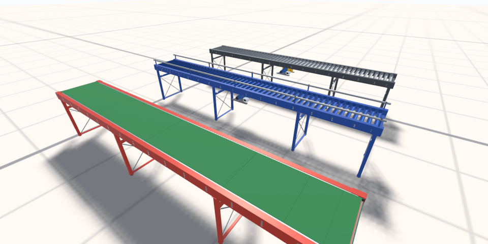
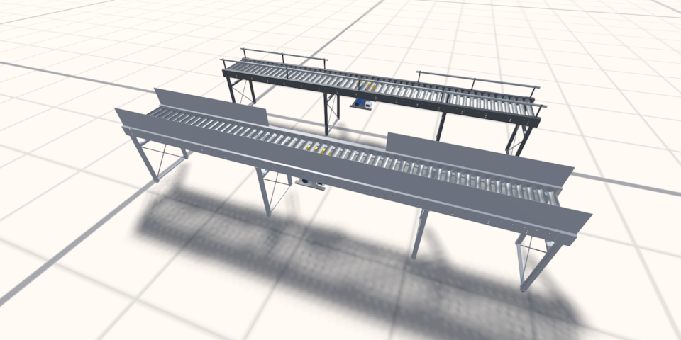
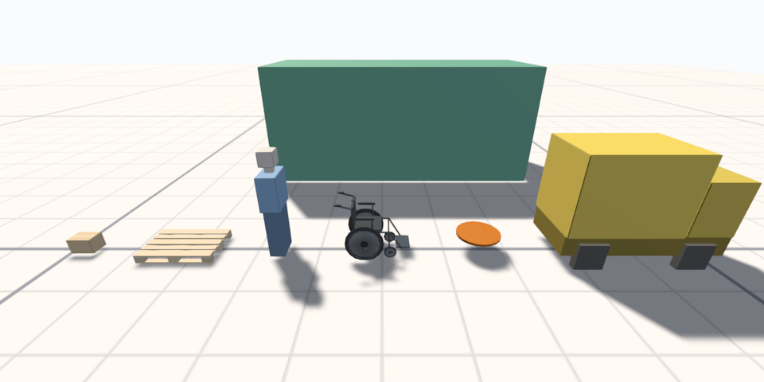

# Appearance

This page is for a developer who wants to draw a Naga model in another tool, such as a game engine, a CAD viewer or a web renderer. The model file says where each conveyor piece stands and how it and each kind of item look, and `nagasim.appearance` reads those values and fills in the defaults, so a drawing needs no copy of the rules. The rules on this page are the reference: the pictures on it come from the reference drawing, which follows them exactly, so a new drawing that follows them too should look the same.

The module is provisional: its names may change between minor versions until a second tool uses it. Every dimension is in metres and every colour is sRGB `#RRGGBB`; for a glTF base colour use `linear_rgb(srgb(color))`.



## Frames of reference

Plan coordinates have x pointing east and y pointing south, in metres. A heading is in degrees clockwise on screen: 0 points east and 90 points south. A drawing that uses y up has to flip one axis, and the headings turn with it. Everything below is stated in these plan coordinates.

An opening's `start` and `end` are measured along the piece's path from its start, in the belt's length unit. `length_factor(document, params)` gives the metres in one unit, and `look_of(params, factor)` applies it, so the openings it returns are already in metres. The openings that diverts and merges cut are not stored in the file; `exit_openings(document, name)` returns them in metres, and a guide is drawn with both lists.

`left` and `right` are seen looking along the flow, from the start of the piece to its end. This holds for guides, openings and the drive alike, so a drawing that mirrors the plan has to swap them back.

## Where a piece stands

A conveyor piece is laid out from its block's `layout_position` and `layout_rotation` along its `path` of straight and arc segments, and four calls read this in metres. `piece_start(document, name)` gives the start pose, `piece_segments(document, name)` the segments, `piece_pose(document, name, distance)` the pose on the centreline at a distance along the path, and `piece_length_m(document, name)` the length. A heading along the path is the direction of travel there; an arc that turns `left` lowers it and one that turns `right` raises it. A CONVEYOR with no `path` is not a piece on the floor: the four calls return None for it, and the reference drawing shows it as a flat tile. Every leg, roller, drive and guide below is placed at a `piece_pose`, offset sideways from the centreline where the rule says so.

## The frame, the rollers and the guides

`height` runs from the floor to the top of the conveying surface, and `width` is the conveyor's width across the outer faces of its side rails. Each side rail is `RAIL_DEPTH_M` (0.05 m) deep from its outer face inwards and `FRAME_HEIGHT_M` (0.1 m) high, its top level with the conveying surface; a pallet piece's rail is the pallet type's own 0.095 m. A roller piece's first roller centre is half a `roller_pitch` from the start, and the next ones follow every `roller_pitch`, the last no nearer than half a pitch to the end; each roller's top is on the conveying surface.

A guide stands on the rail, half the rail's depth (0.025 m) inboard of the outer face, and `guide_left` or `guide_right` is the height of its top above the conveying surface. A `round` or `flat` guide is a rail at that height on posts, which stand 0.05 m in from each end of a run and evenly between, at most 1 m apart (one in the middle of a run too short for two), and a `panel` guide is a plate that fills from the rail up to it. A side exit cuts the guide where `exit_openings` says, and `guide_runs(length, openings, side)` returns the stretches of guide that remain between the openings.



## Where legs and the drive go

Legs and drive are not fields of a look, so this is how the reference drawing places them. Legs stand at 0.05 m from the start and then every `leg_spacing` metres along the path, none nearer than 0.05 m to the end; one more stands 0.05 m before the end when that is more than 0.3 m past the last leg. Each leg reaches from the floor to the underside of the rails, so a piece whose rails reach the floor has none, and a `leg_spacing` of 0 means no legs.

The drive (`drive_side` `under`) hangs under the bed at mid-length on a roller or pallet piece and 0.15 m from the end on a belt or chain piece. `left` and `right` hang it at the same place and height beside the frame, 0.01 m outboard of the rail, and `none` leaves it out. Its top is 0.05 m under the conveying surface and it never goes below the floor; the drive's own size is the drawing's choice. A pallet's drive is always beside the frame, so an `under` value goes to the right, and at a `height` of 0.2 m (`RAISED_PALLET_M`) or lower it stands on the floor. With these rules a drawing places every leg and drive the reference does.

A pallet's `leg_spacing` default follows its height: 0 at or under `RAISED_PALLET_M`, and 1.5 m above it. A `leg_spacing` stored in the piece is kept as it is when the height changes, and `default(kind, field, look)` is the call that reads the follow-the-height rule for a piece that stores none.

## The look fields, the materials and the item forms

A piece's `look` param holds the fields it sets, and `look_of` returns every field of its type with the defaults filled in. The first table lists each field with what it measures, the types that have it, the default for each type and what the validator accepts; a piece with a value outside these is drawn with the default, as `look_of` never raises. A pallet's `leg_spacing` shows its default at the type's own height first and the default above `RAISED_PALLET_M` in brackets, and a hex frame colour `#RRGGBB` is always paint, even `#5E646B`, which is the colour of `steel`: only the name `steel` is drawn as bare metal.

Each look value that names a finish has a material: a colour, a metallic factor and a roughness, as a glTF metallic-roughness material takes them. The second table lists every value and what it paints, with the cap that finishes each guide post, which no look changes. A panel guide is drawn in the frame's material, so the `panel` row is not a colour to use: call `guide_material(style, frame_color)` for any guide, and `material(field, value)` for the other fields, a hex frame colour included.

Each entity type in a model draws as one of seven forms, chosen from its name and its Entities row's `icon`, with a default size when the type declares none. The third table gives each form's size and the rules that choose it, in the order they apply: a pallet first, then the icon word, then a prop word, then the person, vehicle, container and information words, and a carton otherwise. A declared size (length, width and height all set) always wins over the default, and a sized disc is a carton. `forms_of(document)` applies all of this to a whole model; an item is painted in its entity type's colour, and which mesh draws a prop is the renderer's choice.



<!-- appearance-tables:start -->

| Field | Unit | What it measures | Types | belt | roller | chain | pallet | mdr | Allowed values |
|---|---|---|---|---|---|---|---|---|---|
| `width` | metres | across the outer faces of the side rails | all | 0.61 | 0.533 | 1.012 | 1.06 | 0.62 | 0.1 to 3 |
| `height` | metres | from the floor to the top of the conveying surface and of the rails, which are 0.1 m high (a pallet's 0.095 m) | all | 0.762 | 0.762 | 0.775 | 0.095 | 0.762 | 0.1 to 3 (pallet: 0.095 to 3) |
| `frame_color` | name | the frame's finish: rails, end plates, legs and guide posts | all | steel | steel | steel | steel | steel | steel, grey, blue, green, yellow, orange, or a colour #RRGGBB |
| `leg_spacing` | metres | between legs along the path; 0 is no legs | all | 1.5 | 1.5 | 1.5 | 0 (1.5 above 0.2 m height) | 1.5 | 0 or 0.5 to 10 |
| `drive_side` | name | where the drive hangs, seen along the flow; left and right at the height of under | belt, roller, chain, pallet | under | under | under | right | - | under, left, right, none (pallet: left, right, none) |
| `guide_left` | metres | the left guide's top above the conveying surface; 0 is no guide | all | 0 | 0 | 0 | 0 | 0 | 0 to 1.5 |
| `guide_right` | metres | the right guide's top above the conveying surface; 0 is no guide | all | 0 | 0 | 0 | 0 | 0 | 0 to 1.5 |
| `guide_style` | name | a round or flat rail on posts, or a panel up from the rail | all | round | round | round | round | round | round, flat, panel |
| `roller_pitch` | metres | between roller centres along the path; the first is half a pitch in | roller, mdr, pallet | - | 0.0762 | - | 0.1905 | 0.09 | 0.03 to 1 |
| `roller_diameter` | metres | a roller tube's diameter; its top is on the conveying surface | roller, mdr, pallet | - | 0.05 | - | 0.089 | 0.05 | 0.02 to 0.3 |
| `roller_finish` | name | the roller tubes' finish | roller, mdr, pallet | - | zinc | - | zinc | zinc | zinc, grey, blue_sleeve |
| `belt_kind` | name | the belt's surface | belt | black_rubber | - | - | - | - | black_rubber, green_pvc, white_food, plastic_modular |
| `pulley_diameter` | metres | the end pulley's diameter | belt | 0.034 | - | - | - | - | 0.03 to 0.5 |
| `chain_strands` | count | the chain strands across the piece | chain | - | - | 2 | - | - | 1 to 6 |
| `strand_spacing` | metres | between neighbouring strand centres, centred on the piece | chain | - | - | 0.822 | - | - | 0.05 to 1.5 |

| Field | Value | Colour | Metallic | Roughness | What it paints |
|---|---|---|---|---|---|
| `frame_color` | `steel` | `#5E646B` | 0.85 | 0.42 | the rails, end plates, legs, guide posts and panel guides |
| `frame_color` | `grey` | `#8C9199` | 0.15 | 0.42 | the rails, end plates, legs, guide posts and panel guides |
| `frame_color` | `blue` | `#1F4C9E` | 0.15 | 0.42 | the rails, end plates, legs, guide posts and panel guides |
| `frame_color` | `green` | `#337340` | 0.15 | 0.42 | the rails, end plates, legs, guide posts and panel guides |
| `frame_color` | `yellow` | `#F2BF1A` | 0.15 | 0.42 | the rails, end plates, legs, guide posts and panel guides |
| `frame_color` | `orange` | `#EB731A` | 0.15 | 0.42 | the rails, end plates, legs, guide posts and panel guides |
| `belt_kind` | `black_rubber` | `#1C1E21` | 0 | 0.88 | the belt bed, pulley and end plates |
| `belt_kind` | `green_pvc` | `#267340` | 0 | 0.88 | the belt bed, pulley and end plates |
| `belt_kind` | `white_food` | `#EBEBE6` | 0 | 0.88 | the belt bed, pulley and end plates |
| `belt_kind` | `plastic_modular` | `#BFC4CC` | 0 | 0.88 | the belt bed, pulley and end plates |
| `roller_finish` | `zinc` | `#A7AEB4` | 0.75 | 0.5 | the roller tubes |
| `roller_finish` | `grey` | `#737880` | 0.75 | 0.5 | the roller tubes |
| `roller_finish` | `blue_sleeve` | `#2659B2` | 0.75 | 0.5 | the roller tubes |
| `guide_style` | `round` | `#A7AEB4` | 0.75 | 0.5 | the round and flat guide rails |
| `guide_style` | `flat` | `#A7AEB4` | 0.75 | 0.5 | the round and flat guide rails |
| `guide_style` | `panel` | - | - | - | the frame's material |
| `POST_CAP` | - | `#24272B` | 0.1 | 0.6 | the cap on top of each guide post, whatever the look |

| Form | Default size in metres (length x width x height) | When it is chosen |
|---|---|---|
| `carton` | 0.4 x 0.3 x 0.25 (shrunk to the shortest belt part, not below 0.1 long) | the icon box, square; else the default |
| `container` | 6.058 x 2.438 x 2.591 (20 ft) or 12.192 x 2.438 x 2.591 (40 ft) or 13.716 x 2.438 x 2.591 (45 ft) | a name word CONTAINER, FEU, TEU; 20, 40 or 45 beside one of EMPTY, EXPORT, IMPORT, ISO, REEFER, TRANSSHIP, TRANSSHIPMENT |
| `pallet` | 1.2 x 0.8 x 0.144 | a BATCH carrier with a pattern; PALLET in the name |
| `person` | 0.3 x 0.5 x 1.7 | the icon person; a name word CLIENT, CUSTOMER, DOCTOR, GUEST, NURSE, OPERATOR, PASSENGER, PATIENT, PAX, PEDESTRIAN, PEOPLE, PERSON, SHOPPER, STAFF, STUDENT, VISITOR, WORKER |
| `vehicle` | 2.4 x 1.08 x 1.8 | the icon truck; a name word AGV, AMR, BUS, CAR, DRONE, EV, FORKLIFT, LORRY, ROBOT, TRACTOR, TRAILER, TRUCK, TUG, VAN, VEHICLE |
| `disc` | none (a sized disc is a carton) | the icon document, gear, bolt, drop; a name word AIRCRAFT, CALL, DOCUMENT, EMAIL, ESCALATION, FLIGHT, MESSAGE, ORDER, REQUEST, REVIEW, SHIP, SIGNAL, TASK, TICKET, VESSEL |
| `prop` | stretcher: 2.1 x 0.95 x 1.15; wheelchair: 1.14 x 0.674 x 0.94 | a name word STRETCHER, WHEELCHAIR, checked before the person words |

<!-- appearance-tables:end -->

## The public calls

The calls below build a small model with one typed conveyor piece that carries a look and one entity type, and print what a drawing reads. A bundled model has no look, so this is the shortest way to see them with values.

```python
from nagasim import appearance

doc = appearance.ModelDocument({
    "blocks": [{"name": "Belt", "type": "CONVEYOR", "layout_position": [2, 3],
                "layout_rotation": 90, "params": {
        "type": "roller", "path": [{"straight": 4}],
        "look": {"frame_color": "blue", "height": 0.9, "guide_left": 0.1,
                 "openings": [{"side": "left", "start": 1, "end": 1.6}]}}}],
    "entities": [{"name": "PATIENT_STRETCHER"}],
})
block = doc.blocks["Belt"]
print(appearance.piece_start(doc, "Belt"), appearance.piece_length_m(doc, "Belt"))
print(appearance.piece_pose(doc, "Belt", 2))
look = appearance.look_of(block.params, appearance.length_factor(doc, block.params))
print(look["frame_color"], look["height"], look["openings"])
print(appearance.exit_openings(doc, "Belt"))
print(appearance.guide_runs(4, look["openings"], "left"))
frame = appearance.material("frame_color", look["frame_color"])
print(frame, appearance.linear_rgb(appearance.srgb(frame.color)))
print(appearance.guide_material(look["guide_style"], look["frame_color"]))
print(appearance.forms_of(doc))
```

`piece_start`, `piece_length_m` and `piece_pose` place the piece, `look_of` gives the resolved fields and the stored openings, `exit_openings` the gaps the exits cut (none here, as the piece has no divert) and `guide_runs` the guide left between them. `material` and `guide_material` give the surfaces, and `forms_of` the form and size of the entity type. With the rules above, these calls are what a drawing needs from a model; the API pages under Python API list every call of the module and its arguments.
