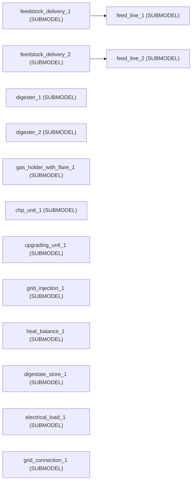

<!-- GENERATED by tools/gen_engine_docs.py -- do not edit by hand. -->
<!-- Regenerate with: python tools/gen_engine_docs.py -->

# Energy

5 of the bundled models. The numbers are from a run made when this page was generated: see [how](index.md#how-the-numbers-are-made).

## Biogas digester, holder and CHP

Digester, gas holder and CHP. A purely CONTINUOUS model: two feedstocks are fed on a daily recipe into a digester that releases biogas over the following days (a yield curve per substrate), the gas is stored in a holder whose methane share is tracked as a component, a CHP burns it under a minimum load and a maintenance failure, and the holder flares what it cannot keep. Base unit hours, 30 days.

```console
naga run biogas_digester_demo
```

1 replication, seed 0:

| KPI | Mean | 95% half-width |
|---|---|---|
| `level/Maize silo/Average` | 557 |  |
| `level/Slurry tank/Average` | 593 |  |
| `level/Gas holder/Average` | 476 |  |

## Biogas plant (library assets)

A farm-scale biogas plant built ONLY from library assets: two feedstock deliveries (an autumn maize campaign and slurry tankers all year) into two feed lines, a 4000 m3 digester and a 2000 m3 post-digester, a 1500 Nm3 gas holder with a flare, a 500 kW CHP unit and a 120 Nm3/h membrane upgrading plant sharing the gas in merit order, grid injection, the heat balance, a 12 000 m3 digestate store on seasonal spreading windows, and the Energy library's site load and grid connection on the same electricity bus. Nothing is wired except the two truck links: everything continuous meets on the site bus. Base unit hours, one simulated YEAR of REAL DATES from the maize harvest on Monday 7 September 2026 (Europe/Rome): the campaign is a weekday delivery pattern that a dated exception closes when the harvest ends, the spreading windows are dated weeks, and the power price repeats "weekly" in calendar terms.

```console
naga run biogas_plant_library
```



1 replication, seed 0:

| KPI | Mean | 95% half-width |
|---|---|---|
| `system/Total Entities Completed` | 1,290 |  |
| `system/Avg Throughput Time` | 0.58 |  |
| `system/Avg Queue Length` | 0 |  |
| `system/Avg Resource Usage %` | 0 |  |
| `user/feedstock_delivery_1/Bio tonnes delivered` | 10,400 |  |
| `user/feedstock_delivery_2/Bio tonnes delivered` | 21,900 |  |
| `user/feed_line_1/Bio tonnes stored` | 10,400 |  |
| `level/feed_line_1/Bio Feed store/Average` | 5,300 |  |
| `level/feed_line_2/Bio Feed store/Average` | 516 |  |
| `level/digester_1/Bio Digester content/Average` | 3,960 |  |

## Depot: PV, EV charging and heat pump

A depot on one electricity bus: a PV roof, the building's own load, twenty EV charge points and a heat-pump water tank, with a grid connection closing the balance. Nothing is wired -- the five assets meet on the named flow tags FLOWSUM() adds up, and the tank adds a SECOND medium (heat) fed from the same bus through its COP. Base unit hours, one week.

```console
naga run energy_heat_and_ev
```

1 replication, seed 0:

| KPI | Mean | 95% half-width |
|---|---|---|
| `level/evs/Nrg EV demand/Average` | 0 |  |
| `level/tank/Nrg Heat tank/Average` | 350 |  |
| `system/Total Cost` | 1,520 |  |

## PV + battery sizing and dispatch

PV + battery sizing and dispatch. A purely CONTINUOUS model: no entities, no queues -- a daily PV profile, a household load profile and a time-of-use tariff drive a battery with power limits and round-trip efficiency, under a simple rule dispatch (charge on surplus, discharge on deficit). Base unit hours, one week.

```console
naga run energy_pv_battery
```

1 replication, seed 0:

| KPI | Mean | 95% half-width |
|---|---|---|
| `level/Battery/Average` | 4.35 |  |
| `system/Total Cost` | 6.02 |  |

## PV + battery site (library assets)

A PV + battery site built entirely from the Energy and grid library: a PV array, a household load, a battery on the self-consumption rule and a grid connection with a time-of-use tariff and a carbon-intensity profile. Nothing is wired: the four assets meet on the site BUS, the named flow tags that FLOWSUM() adds up. Base unit hours, the real week of Monday 15 June 2026 in Europe/Rome: the daily PV, load, tariff and carbon profiles repeat "daily" in calendar terms and every result axis is a date.

```console
naga run energy_site_library
```

1 replication, seed 0:

| KPI | Mean | 95% half-width |
|---|---|---|
| `level/battery_storage_1/Nrg Battery/Average` | 4.19 |  |
| `system/Total Cost` | 19.2 |  |
