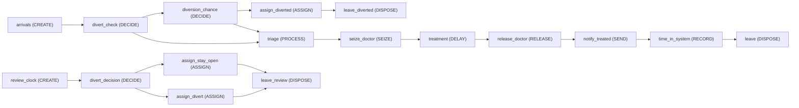
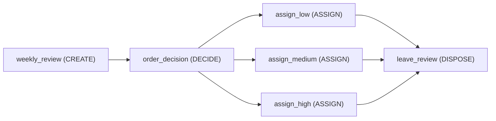

<!-- GENERATED by tools/gen_engine_docs.py -- do not edit by hand. -->
<!-- Regenerate with: python tools/gen_engine_docs.py -->

# Games

2 of the bundled models. The numbers are from a run made when this page was generated: see [how](index.md#how-the-numbers-are-made).

## Emergency department: staffing game

A staffing game built on ed_patient_agents: patients run the same Stable -> Deteriorating -> Critical statechart through triage and a Doctor queue ranked by entity.agent.acuity. Two controls let a player staff Doctor (1-4) and Nurse (1-3) up or down mid-run; every 8 hours a Policy-mode DECIDE ('divert') asks whether to divert ambulances, which turns away 60% of new arrivals until reviewed again. In the results, read the doctor queue, doctor utilisation, waiting against critical patients, the acuity mix and the diverted count.

```console
naga run ed_game
```



3 replications, seed 0:

| KPI | Mean | 95% half-width |
|---|---|---|
| `system/Total Entities Completed` | 325 | 37 |
| `system/Avg Throughput Time` | 0.632 | 0.059 |
| `system/Avg Queue Length` | 0.0564 | 0.045 |
| `system/Avg Resource Usage %` | 31.3 | 5.6 |
| `user/time_in_system` | 0.656 | 0.059 |
| `agent/Patients/Stable/Avg Count` | 1.29 | 0.33 |
| `agent/Patients/Deteriorating/Avg Count` | 0.592 | 0.11 |
| `agent/Patients/Critical/Avg Count` | 0.427 | 0.091 |
| `agent/Patients/Discharged/Avg Count` | 0 | 0 |

## Supply line: order-rate management game

A one-echelon, beer-game-style supply line: Inventory is replenished from a Supply Line pipeline through a 3rd-order shipping delay (DELAY3); customer demand steps up in week 5. A negative Inventory level IS the backlog, so one stock covers both. Every week a Policy-mode DECIDE ('order') asks the player to set the order rate low/medium/high, with a finer control beside it; Total Cost accumulates holding and backorder cost. In the results, read on-hand inventory against backlog, total cost and the service level.

```console
naga run sd_supply_game
```



1 replication, seed 0:

| KPI | Mean | 95% half-width |
|---|---|---|
| `system/Total Entities Completed` | 41 |  |
| `system/Avg Throughput Time` | 0 |  |
| `level/Inventory/Average` | -54.7 |  |
| `level/Supply Line/Average` | 52.8 |  |
| `level/Total Cost/Average` | 1,260 |  |
