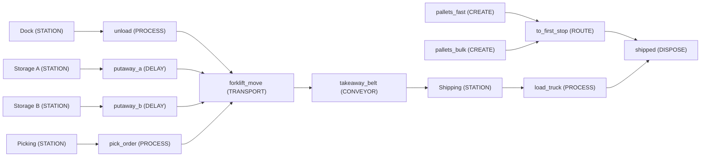
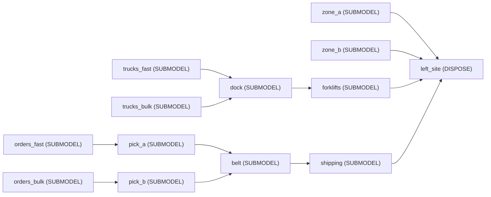

<!-- GENERATED by tools/gen_engine_docs.py -- do not edit by hand. -->
<!-- Regenerate with: python tools/gen_engine_docs.py -->

# Logistics

2 of the bundled models. The numbers are from a run made when this page was generated: see [how](index.md#how-the-numbers-are-made).

## Warehouse with forklifts (floor plan)

A small warehouse on a real-metre floor plan: pallets are unloaded at the dock, driven by forklift to one of two storage zones, driven again to picking, and leave on a take-away conveyor to shipping. Travel time is geometry -- distance along the aisle network divided by the forklift speed -- so moving the dock or adding a truck changes the KPIs the way hand reasoning says it should.

```console
naga run warehouse_forklifts --replications 3
```



3 replications, seed 0:

| KPI | Mean | 95% half-width |
|---|---|---|
| `system/Total Entities Completed` | 306 | 19 |
| `system/Avg Throughput Time` | 23.8 | 1.9 |
| `system/Avg Queue Length` | 1.17 | 0.75 |
| `system/Avg Resource Usage %` | 63.4 | 4.1 |
| `system/Total Cost` | 3,700 | 73 |

## Order-driven warehouse (library assets)

An order-driven warehouse built from the Logistics library alone: inbound trucks, a receiving dock, forklifts putting pallets away into two rack zones that HOLD them as stock, customer orders drawing that stock with backorders when it is short, order picking, a take-away belt and an outbound dock that consolidates truck loads. Inbound and outbound are two entity streams that meet at each zone's level; each asset brought its own network node when it was placed, and the aisles joining them are the only geometry drawn by hand.

```console
naga run warehouse_library --replications 3
```



3 replications, seed 0:

| KPI | Mean | 95% half-width |
|---|---|---|
| `system/Total Entities Completed` | 435 | 35 |
| `system/Avg Throughput Time` | 44.7 | 25 |
| `system/Avg Queue Length` | 6.15 | 1.3 |
| `system/Avg Resource Usage %` | 46.4 | 2.2 |
| `user/pick_a/Log fill rate` | 0.98 | 0.045 |
| `user/pick_a/Log backorder time` | 0.117 | 0.36 |
| `user/pick_b/Log fill rate` | 0.8 | 0.86 |
| `level/zone_a/Log Zone stock/Average` | 12.5 | 11 |
| `level/zone_b/Log Zone stock/Average` | 29.6 | 54 |
| `system/Total Cost` | 1,070 | 13 |
