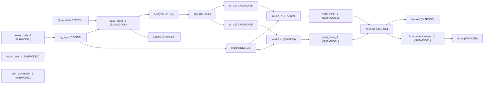
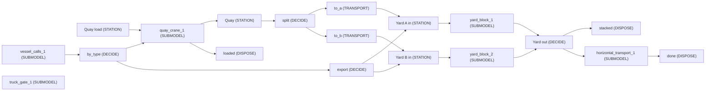
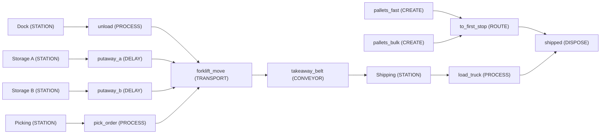
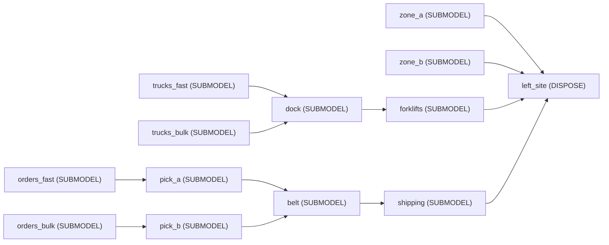

<!-- GENERATED by tools/gen_engine_docs.py -- do not edit by hand. -->
<!-- Regenerate with: python tools/gen_engine_docs.py -->

# Logistics

6 of the bundled models. The numbers are from a run made when this page was generated: see [how](index.md#how-the-numbers-are-made).

## Hub day: electrifying the ground support equipment

The hub day of the turnaround workload model with its ground support equipment's energy priced and counted: diesel as it is, the same fleets electric at the same counts charging in a night window or whenever a vehicle is free, and the latter with spares. The question it answers: what do energy cost, CO2 and the grid's peak become, do departures stay on time, and does the extra capital pay back? Read on_time_departure, the flow summary (fuel and grid kWh, peak kW), the battery summary (depleted events) and the investment case across scenarios. Illustrative figures.

```console
naga run gse_electrification
```

1 replication, seed 0:

| KPI | Mean | 95% half-width |
|---|---|---|
| `system/Total Entities Completed` | 570 |  |
| `system/Avg Throughput Time` | 57.1 |  |
| `system/Avg Queue Length` | 7.71 |  |
| `system/Avg Resource Usage %` | 41.2 |  |
| `user/on_time_departure` | 0.868 |  |
| `user/turnaround_wide_min` | 86 |  |
| `user/turnaround_narrow_min` | 56.7 |  |
| `system/Total Cost` | 39,900 |  |

## Container terminal: electrification

The quay-to-yard terminal with its straddle carriers' energy priced and counted: diesel as it is, battery straddle carriers charging opportunistically, and AGVs on pack swap. The question it answers: what do energy cost, CO2 and the grid's peak become, and does the extra capital pay back? Read the flow summary (fuel and grid kWh, peak kW), the cost summary, and the investment case across scenarios. Illustrative figures.

```console
naga run terminal_electrification
```



1 replication, seed 0:

| KPI | Mean | 95% half-width |
|---|---|---|
| `system/Total Entities Completed` | 9,030 |  |
| `system/Avg Throughput Time` | 544 |  |
| `system/Avg Queue Length` | 482 |  |
| `system/Avg Resource Usage %` | 35.2 |  |
| `user/truck_gate_1/truck turn time` | 130 |  |
| `system/Total Cost` | 182,000 |  |

## Container terminal: quay to yard

One berth with three quay cranes, straddle carriers between the quay and two yard blocks with an RTG each, a truck gate, and a week of synthetic vessel calls. The question it answers: how many straddle carriers per crane keep the cranes at their target moves per hour? In the results, read the crane pool's seizes (gross moves), the order summary (vessel turn time per call), the fleet summary (carrier utilisation and waiting) and the truck turn time. Illustrative figures.

```console
naga run terminal_quay_to_yard
```



1 replication, seed 0:

| KPI | Mean | 95% half-width |
|---|---|---|
| `system/Total Entities Completed` | 9,030 |  |
| `system/Avg Throughput Time` | 544 |  |
| `system/Avg Queue Length` | 482 |  |
| `system/Avg Resource Usage %` | 35.2 |  |
| `user/truck_gate_1/truck turn time` | 130 |  |
| `system/Total Cost` | 152,000 |  |

## Hub day: turnaround workload (crews, ground equipment, on-time departures)

A synthetic hub day for a ground handler: about 114 flights in three banks on ten stands (eight contact for narrow-bodies, two remote for wide-bodies). Each turnaround draws on one ramp crew on three shifts and on diesel ground equipment, one fleet per type. The flights are read from data/airport_flight_schedule.csv at run time, so tomorrow's file replaces today's. In the results, read on_time_departure (share of flights off block by their scheduled time), the turnaround times by aircraft class, the hourly crew and equipment series, and the request wait of each equipment fleet. Time 0 is 04:00. Synthetic data; the task times are estimates.

```console
naga run turnaround_workload
```

1 replication, seed 0:

| KPI | Mean | 95% half-width |
|---|---|---|
| `system/Total Entities Completed` | 570 |  |
| `system/Avg Throughput Time` | 57.1 |  |
| `system/Avg Queue Length` | 7.71 |  |
| `system/Avg Resource Usage %` | 41.2 |  |
| `user/on_time_departure` | 0.868 |  |
| `user/turnaround_wide_min` | 86 |  |
| `user/turnaround_narrow_min` | 56.7 |  |
| `system/Total Cost` | 36,700 |  |

## Warehouse with forklifts (floor plan)

A small warehouse on a real-metre floor plan: pallets are unloaded at the dock, driven by forklift to one of two storage zones, driven again to picking, and leave on a take-away conveyor to shipping. Travel time is geometry -- distance along the aisle network divided by the forklift speed -- so moving the dock or adding a truck changes the KPIs the way hand reasoning says it should.

```console
naga run warehouse_forklifts --replications 3
```



3 replications, seed 0:

| KPI | Mean | 95% half-width |
|---|---|---|
| `system/Total Entities Completed` | 306 | 19 |
| `system/Avg Throughput Time` | 23.8 | 1.9 |
| `system/Avg Queue Length` | 1.17 | 0.75 |
| `system/Avg Resource Usage %` | 63.4 | 4.1 |
| `system/Total Cost` | 3,700 | 73 |

## Order-driven warehouse (library assets)

An order-driven warehouse built from the Logistics library alone: inbound trucks, a receiving dock, forklifts putting pallets away into two rack zones that HOLD them as stock, customer orders drawing that stock with backorders when it is short, order picking, a take-away belt and an outbound dock that consolidates truck loads. Inbound and outbound are two entity streams that meet at each zone's level; each asset brought its own network node when it was placed, and the aisles joining them are the only geometry drawn by hand.

```console
naga run warehouse_library --replications 3
```



3 replications, seed 0:

| KPI | Mean | 95% half-width |
|---|---|---|
| `system/Total Entities Completed` | 435 | 35 |
| `system/Avg Throughput Time` | 44.7 | 25 |
| `system/Avg Queue Length` | 6.15 | 1.3 |
| `system/Avg Resource Usage %` | 46.4 | 2.2 |
| `user/pick_a/Log fill rate` | 0.98 | 0.045 |
| `user/pick_a/Log backorder time` | 0.117 | 0.36 |
| `user/pick_b/Log fill rate` | 0.8 | 0.86 |
| `level/zone_a/Log Zone stock/Average` | 12.5 | 11 |
| `level/zone_b/Log Zone stock/Average` | 29.6 | 54 |
| `system/Total Cost` | 1,070 | 13 |
