<!-- GENERATED by tools/gen_engine_docs.py -- do not edit by hand. -->
<!-- Regenerate with: python tools/gen_engine_docs.py -->

# Manufacturing

11 of the bundled models. The numbers are from a run made when this page was generated: see [how](index.md#how-the-numbers-are-made).

## Robot cell against manual assembly

A short line whose assembly station is manual as saved (a MOTION cycle with a human profile, an operator at 30 per hour) and a robot cell in the scenario "Robot cell" (a robot profile and cycle, 2 per hour of maintenance, 85 000 of capex). Its investment section compares the scenario with the saved model: `naga invest` gives payback, NPV and ROI, and `naga scenarios` the throughput and cost of each. Illustrative figures.

```console
naga run automation_cell --replications 3
```

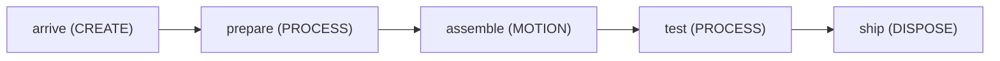

3 replications, seed 0:

| KPI | Mean | 95% half-width |
|---|---|---|
| `system/Total Entities Completed` | 571 | 63 |
| `system/Avg Throughput Time` | 183 | 97 |
| `system/Avg Queue Length` | 2.02 | 2.1 |
| `system/Avg Resource Usage %` | 55 | 6.1 |
| `system/Total Cost` | 240 | 0 |

## Automation floor (robot cells, AMR, palletiser)

Every asset of the Automation library on one floor: a robot arm cell and a cobot cell in line, an AMR shuttle to a palletiser, and mobile cobots tending a lathe. In the results, read the motion summary (each arm's cycle by phase), the fleet's trips and waiting, and the tending summary for the lathe. Illustrative figures.

```console
naga run automation_floor
```

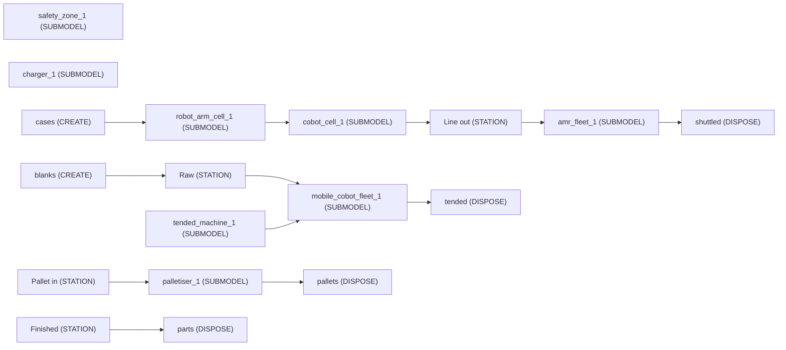

3 replications, seed 0:

| KPI | Mean | 95% half-width |
|---|---|---|
| `system/Total Entities Completed` | 30 | 0 |
| `system/Avg Throughput Time` | 59.3 | 0 |
| `system/Avg Queue Length` | 3.42 | 0 |
| `system/Avg Resource Usage %` | 45.8 | 0 |
| `system/Total Cost` | 380,000 | 0 |

## Job shop (Jackson network)

Three-station job shop (Cutting, then a 0.6/0.4 split to Drilling or Assembly, with a 0.2 rework loop back to Cutting) modelled as an open Jackson network -- costed resources, a WIP holding cost, and two example scenarios (extra Assembly capacity, less rework).

```console
naga run job_shop_jackson --replications 3
```

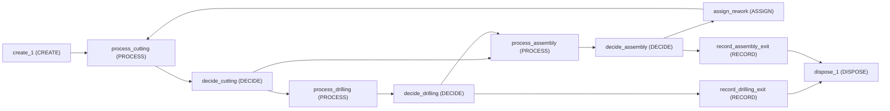

3 replications, seed 0:

| KPI | Mean | 95% half-width |
|---|---|---|
| `system/Total Entities Completed` | 8,060 | 180 |
| `system/Avg Throughput Time` | 8.67 | 0.93 |
| `system/Avg Queue Length` | 5.14 | 1.1 |
| `system/Avg Resource Usage %` | 71.4 | 1.4 |
| `user/time_in_system` | 8.67 | 0.93 |
| `system/Total Cost` | 27,000 | 630 |

## Job shop (routed, per-product sequences)

The three-station job shop of job_shop_jackson.json rebuilt with ROUTE, STATION blocks and per-product routing sequences instead of DECIDE wiring. Three products follow fixed operation orders (Shaft visits Cutting twice, which no drawn flow could express without duplicating the station), each step carries its own process time, travel time between stations comes from a from-to Distance table, and a scenario switches on a sequence-dependent setup at Cutting.

```console
naga run job_shop_routed --replications 3
```

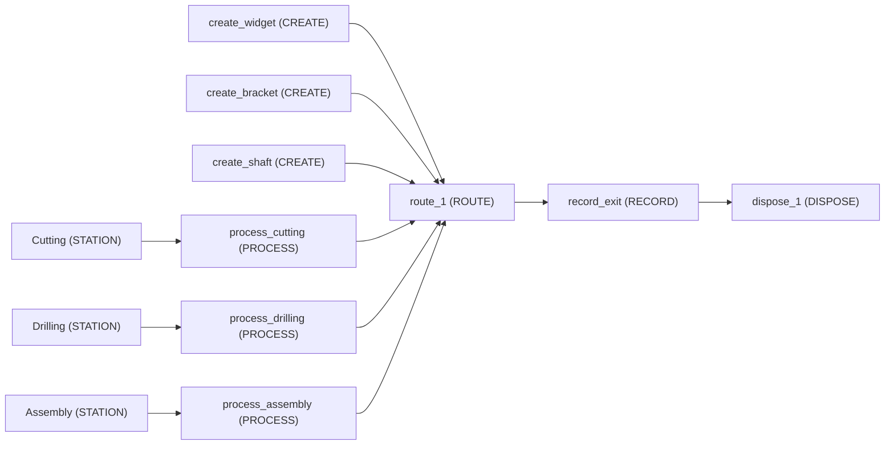

3 replications, seed 0:

| KPI | Mean | 95% half-width |
|---|---|---|
| `system/Total Entities Completed` | 4,970 | 140 |
| `system/Avg Throughput Time` | 8.65 | 0.18 |
| `system/Avg Queue Length` | 3.52 | 0.31 |
| `system/Avg Resource Usage %` | 66.3 | 2 |
| `user/time_in_system` | 8.65 | 0.18 |
| `system/Total Cost` | 16,400 | 370 |

## Line with finite buffers

A four-station line with finite buffers between the stations: when a buffer is full the machine behind it stays BLOCKED, holding its finished part. Station 3 breaks down often, so where the twelve available buffer places go decides the line's throughput -- the scenarios move them around without ever adding any.

```console
naga run line_with_buffers --replications 3
```

```mermaid
flowchart LR
    b0["release (CREATE)"]
    b1["station_1 (SUBMODEL)"]
    b2["station_2 (SUBMODEL)"]
    b3["buffer_1 (SUBMODEL)"]
    b4["station_3 (SUBMODEL)"]
    b5["buffer_2 (SUBMODEL)"]
    b6["station_4 (SUBMODEL)"]
    b7["buffer_3 (SUBMODEL)"]
    b8["finished (DISPOSE)"]
    b0 --> b1
    b1 --> b3
    b3 --> b2
    b2 --> b5
    b5 --> b4
    b4 --> b7
    b7 --> b6
    b6 --> b8
```

3 replications, seed 0:

| KPI | Mean | 95% half-width |
|---|---|---|
| `system/Total Entities Completed` | 1,520 | 300 |
| `system/Avg Throughput Time` | 400 | 230 |
| `system/Avg Queue Length` | 392 | 190 |
| `system/Avg Resource Usage %` | 73.4 | 3.3 |
| `level/buffer_1/Mfg Buffer stock/Average` | 2.91 | 0.8 |
| `level/buffer_2/Mfg Buffer stock/Average` | 2.8 | 0.63 |
| `level/buffer_3/Mfg Buffer stock/Average` | 1.05 | 1 |
| `system/Total Cost` | 59.7 | 5.6 |

## Machine with breakdowns

A single Machine subject to random failures (uptime/downtime distributions) -- shows how a resource failure interrupts and resumes service.

```console
naga run machine_with_breakdowns --replications 3
```

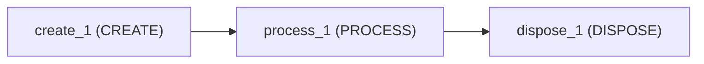

3 replications, seed 0:

| KPI | Mean | 95% half-width |
|---|---|---|
| `system/Total Entities Completed` | 1,780 | 29 |
| `system/Avg Throughput Time` | 4.18 | 1.9 |
| `system/Avg Queue Length` | 1.61 | 1 |
| `system/Avg Resource Usage %` | 55.1 | 3 |

## Job shop with MES digital twin

A three-station job shop built from Manufacturing library Routed stations, driven by a Manufacturing Execution System. Two products follow their own routings, process times come from a lookup table the MES parameter feed refits, and each station breaks down. On its own it runs as a plain job shop; an MES twin runs it against the mock MES in models/data/mes_twin_shop/ with the mapping in models/data/mes_twin_shop.mesmap.json.

```console
naga run mes_twin_shop --replications 3
```

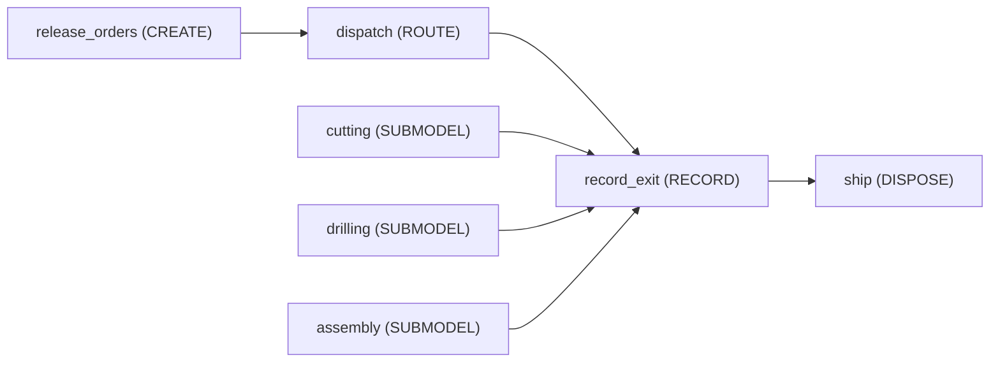

3 replications, seed 0:

| KPI | Mean | 95% half-width |
|---|---|---|
| `system/Total Entities Completed` | 6.33 | 3.8 |
| `system/Avg Throughput Time` | 94 | 2.2 |
| `system/Avg Queue Length` | 0.659 | 1 |
| `system/Avg Resource Usage %` | 41.9 | 1.2 |
| `user/shop_floor_time` | 94 | 2.2 |
| `system/Total Cost` | 26 | 5 |

## Make-to-order line (library assets)

A small make-to-order line built entirely from Manufacturing 1.0.0 assets, and deliberately still on those v1 definitions (the library has a 2.0.0 since). Jobs are released every 6 minutes into a CONWIP loop of 12 tokens, baked four to a load, machined, then inspected -- 85% pass, 10% go back to the machine, 5% are scrapped, and every job gives its token back whichever way it leaves. All four resources run at 60-85%, so the queues, the rework loop and the oven's batching are all visible in the results.

```console
naga run mfg_line_library
```

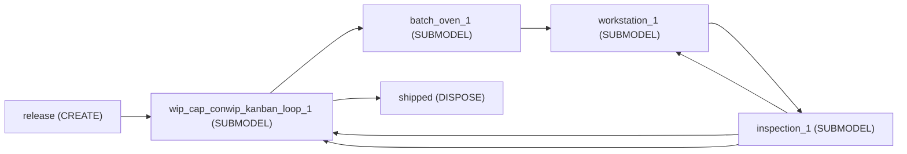

3 replications, seed 0:

| KPI | Mean | 95% half-width |
|---|---|---|
| `system/Total Entities Completed` | 268 | 5.2 |
| `system/Avg Throughput Time` | 45.2 | 16 |
| `system/Avg Queue Length` | 4.24 | 2.9 |
| `system/Avg Resource Usage %` | 58.3 | 11 |
| `system/Total Cost` | 8.88 | 2.7 |

## Orders, due dates and tardiness

Three released work orders through a two-station routed shop, every process time a constant, so every completion time, lateness and tardiness is exact arithmetic. The smallest model that shows orders, due dates and the two KPI frames they fill.

```console
naga run order_due_dates
```

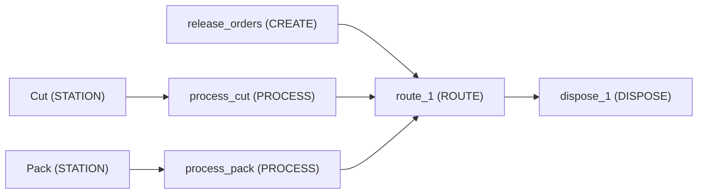

1 replication, seed 0:

| KPI | Mean | 95% half-width |
|---|---|---|
| `system/Total Entities Completed` | 4 |  |
| `system/Avg Throughput Time` | 6.5 |  |
| `system/Avg Queue Length` | 1.09 |  |
| `system/Avg Resource Usage %` | 63.6 |  |

## Priority jobs with rework

Jobs arrive with a random priority and can be sent back for rework up to twice (20% chance each pass); RECORD blocks tally the rework count and the extra time in system it costs.

```console
naga run priority_rework
```

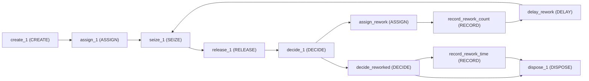

2 replications, seed 0:

| KPI | Mean | 95% half-width |
|---|---|---|
| `system/Total Entities Completed` | 292 | 100 |
| `system/Avg Throughput Time` | 14.6 | 41 |
| `system/Avg Queue Length` | 14.5 | 53 |
| `system/Avg Resource Usage %` | 97.9 | 16 |
| `user/rework_events` | 64.5 | 6.4 |
| `user/time_in_system_reworked` | 24.8 | 45 |

## Two-cell line (reusable submodel)

Two identical work cells built from one reusable submodel definition Cell(rate, servers): a machine on a per-instance `$Machine` resource with a 10% rework loop. An open Jackson network of two M/M/1 nodes with feedback.

```console
naga run two_cell_line --replications 3
```

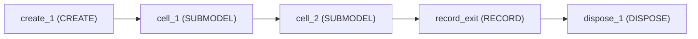

3 replications, seed 0:

| KPI | Mean | 95% half-width |
|---|---|---|
| `system/Total Entities Completed` | 4,010 | 130 |
| `system/Avg Throughput Time` | 5.31 | 0.93 |
| `system/Avg Queue Length` | 2.94 | 0.76 |
| `system/Avg Resource Usage %` | 66.6 | 2 |
| `user/time_in_system` | 5.31 | 0.92 |
