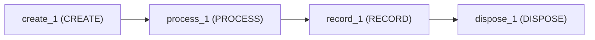
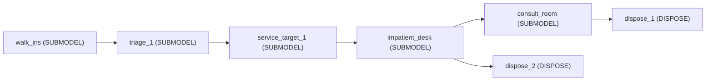
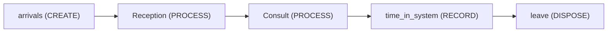
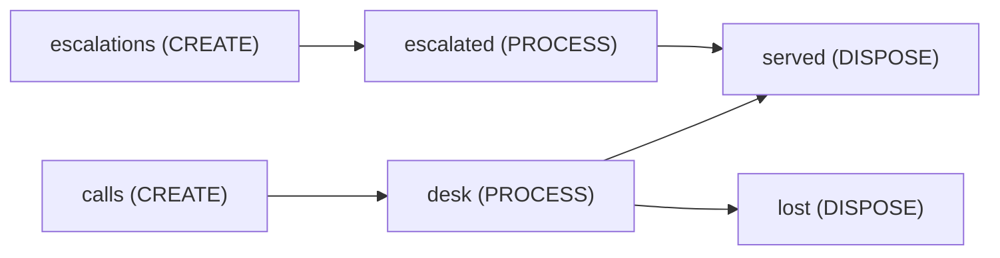

```mermaid
flowchart LR
    b0["arrivals (CREATE)"]
    b1["triage (PROCESS)"]
    b2["seize_doctor (SEIZE)"]
    b3["critical_share (RECORD)"]
    b4["treatment (DELAY)"]
    b5["release_doctor (RELEASE)"]
    b6["notify_treated (SEND)"]
    b7["time_in_system (RECORD)"]
    b8["leave (DISPOSE)"]
    b0 --> b1
    b1 --> b2
    b2 --> b3
    b3 --> b4
    b4 --> b5
    b5 --> b6
    b6 --> b7
    b7 --> b8
```

<!-- GENERATED by tools/gen_engine_docs.py -- do not edit by hand. -->
<!-- Regenerate with: python tools/gen_engine_docs.py -->

# Services

6 of the bundled models. The numbers are from a run made when this page was generated: see [how](index.md#how-the-numbers-are-made).

## Call centre on real dates

A call centre on REAL DATES: the week of Monday 5 January 2026, Europe/Rome. The arrival rate and the agent roster are both weekday schedules in local wall-clock time -- Mon-Fri 08:00-16:00, a short Saturday morning, Sunday closed -- with Epiphany (Tuesday 6 January) closed by a dated exception. RECORD tracks each call's time in system; every chart, the playback clock and the exported workbook show the real day and hour.

```console
naga run call_centre_day --replications 3
```



3 replications, seed 0:

| KPI | Mean | 95% half-width |
|---|---|---|
| `system/Total Entities Completed` | 1,300 | 47 |
| `system/Avg Throughput Time` | 15.3 | 29 |
| `system/Avg Queue Length` | 2.08 | 4.2 |
| `system/Avg Resource Usage %` | 71.5 | 1.7 |
| `user/time_in_system` | 15.3 | 29 |

## Walk-in clinic (library assets)

One 10-hour day of a walk-in clinic, built entirely from the Services and healthcare library. Walk-ins arrive on a time-of-day schedule (two peaks, about 125 patients), Triage stamps an acuity class and priority, a service target stamps a 45-minute due date, a one-person registration desk models balking and reneging (its 'left' exit is left-without-being-seen) and a consultation room -- a room plus a clinician -- serves the registered patients most-urgent-first. A clinic day is a TERMINATING simulation, so it runs with no warm-up: the quiet start and the end-of-day tail are part of the answer, not transient error to discard.

```console
naga run clinic_library --replications 3
```



3 replications, seed 0:

| KPI | Mean | 95% half-width |
|---|---|---|
| `system/Total Entities Completed` | 135 | 52 |
| `system/Avg Throughput Time` | 25 | 10 |
| `system/Avg Queue Length` | 3.41 | 2.6 |
| `system/Avg Resource Usage %` | 74.5 | 18 |

## Walk-in clinic digital twin

Walk-in clinic as a digital twin: the consultation time and the arrival profile are read from data/clinic_visits.csv at run time, and the day starts with a waiting room that is already half full. Forecast it with: naga forecast clinic_twin --horizon 480 --replications 200 --event "timeseries/resource/Doctor/queue/max>8"

```console
naga run clinic_twin --replications 3
```



3 replications, seed 0:

| KPI | Mean | 95% half-width |
|---|---|---|
| `system/Total Entities Completed` | 69.7 | 15 |
| `system/Avg Throughput Time` | 20.9 | 11 |
| `system/Avg Queue Length` | 1.3 | 0.85 |
| `system/Avg Resource Usage %` | 47.2 | 6.1 |
| `user/time_in_system` | 20.9 | 11 |

## Emergency department: bedside scan (film template)

A teaching model for the Film dock: walk-in patients in a small emergency department on a 32 x 17 m floor plan go through triage, wait for one of five exam bays, see a doctor and leave with a decision. Two scenarios run with common random numbers: the usual pathway waits for blood tests before deciding, the other scans at the bed first. Every number is invented for teaching; none comes from a real hospital.

```console
naga run ed_bedside_scan --replications 3
```

3 replications, seed 0:

| KPI | Mean | 95% half-width |
|---|---|---|
| `system/Total Entities Completed` | 29.3 | 23 |
| `system/Avg Throughput Time` | 127 | 43 |
| `system/Avg Queue Length` | 1.09 | 2.2 |
| `system/Avg Resource Usage %` | 59.8 | 39 |
| `user/arrival_to_decision` | 126 | 43 |

## Emergency department with patient agents

A patient is both a DES entity and an agent (CREATE's population param). Each patient's Patient agent runs a Stable -> Deteriorating -> Critical statechart (rate transitions, 1/hour) alongside the queueing flow (arrival, triage, doctor); the doctor's queue reads the live entity.agent.acuity (Doctor's HighestValueFirst discipline, ranking_expr) so a patient who has deteriorated while waiting is served ahead of a Stable one queued earlier. A RECORD block reads entity.agent.state to tally the share already Critical when treatment starts, and SEND messages entity.agent (its default target) with "treated" once the doctor releases it, driving every state to Discharged; DISPOSE then removes the agent with remove_agent.

```console
naga run ed_patient_agents --replications 3
```



3 replications, seed 0:

| KPI | Mean | 95% half-width |
|---|---|---|
| `system/Total Entities Completed` | 539 | 85 |
| `system/Avg Throughput Time` | 1.75 | 1.6 |
| `system/Avg Queue Length` | 3.28 | 4.5 |
| `system/Avg Resource Usage %` | 48 | 11 |
| `user/critical_at_treatment_start` | 0.461 | 0.29 |
| `user/time_in_system` | 1.75 | 1.6 |
| `agent/Patients/Stable/Avg Count` | 1.32 | 0.62 |
| `agent/Patients/Deteriorating/Avg Count` | 1.01 | 0.67 |
| `agent/Patients/Critical/Avg Count` | 2.07 | 3.5 |
| `agent/Patients/Discharged/Avg Count` | 0 | 0 |

## Impatient customers (balking and reneging)

```console
naga run impatient_customers --replications 3
```



3 replications, seed 0:

| KPI | Mean | 95% half-width |
|---|---|---|
| `system/Total Entities Completed` | 239 | 25 |
| `system/Avg Throughput Time` | 5.49 | 0.98 |
| `system/Avg Queue Length` | 1.39 | 0.24 |
| `system/Avg Resource Usage %` | 85.6 | 4.2 |
| `system/Total Cost` | 600 | 8.9 |
