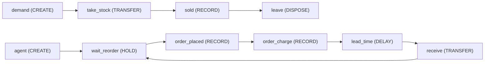
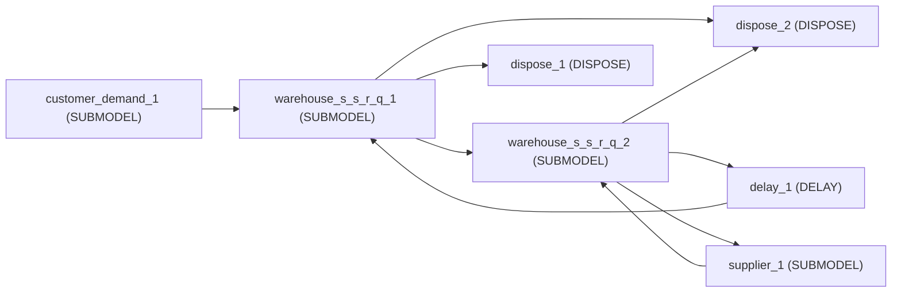

<!-- GENERATED by tools/gen_engine_docs.py -- do not edit by hand. -->
<!-- Regenerate with: python tools/gen_engine_docs.py -->

# Supply chain

2 of the bundled models. The numbers are from a run made when this page was generated: see [how](index.md#how-the-numbers-are-made).

## (s, S) inventory with backorders

(s, S) inventory control with a replenishment lead time and backorders. Stock is a LEVEL; customers are entities that draw from it through a TRANSFER block and WAIT when it is short -- the backorder. A falling threshold at s fires the reorder signal that releases the purchasing agent. Base unit days.

```console
naga run inventory_sS
```



1 replication, seed 0:

| KPI | Mean | 95% half-width |
|---|---|---|
| `system/Total Entities Completed` | 137 |  |
| `system/Avg Throughput Time` | 0 |  |
| `user/units_sold` | 685 |  |
| `user/orders_placed` | 10 |  |
| `level/Stock/Average` | 49.7 |  |
| `system/Total Cost` | 350 |  |

## Two-echelon supply chain (library assets)

A two-echelon supply chain built entirely from the Supply chain and inventory library: customers draw from a store on an (s, S) policy with lost sales, the store's replenishment orders are demand at a central warehouse that backorders, and the central warehouse buys from a capacitated supplier. Each echelon's lead time is the next one's queueing outcome, not a number. Base unit days.

```console
naga run supply_chain_library --replications 3
```



3 replications, seed 0:

| KPI | Mean | 95% half-width |
|---|---|---|
| `system/Total Entities Completed` | 697 | 94 |
| `system/Avg Throughput Time` | 0 | 0 |
| `system/Avg Queue Length` | 1.75 | 0.039 |
| `system/Avg Resource Usage %` | 2.3 | 1 |
| `user/warehouse_s_s_r_q_1/Scm fill rate` | 0.981 | 0.014 |
| `user/warehouse_s_s_r_q_1/Scm units served` | 2,390 | 410 |
| `user/warehouse_s_s_r_q_1/Scm units lost` | 57.3 | 37 |
| `level/warehouse_s_s_r_q_1/Scm Stock/Average` | 31.1 | 1.6 |
| `level/warehouse_s_s_r_q_1/Scm On order/Average` | 7.94 | 1.4 |
| `level/warehouse_s_s_r_q_2/Scm Stock/Average` | 160 | 3.6 |
| `system/Total Cost` | 426 | 15 |
