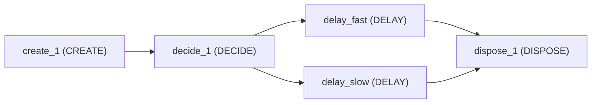
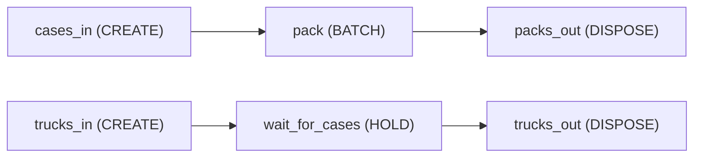
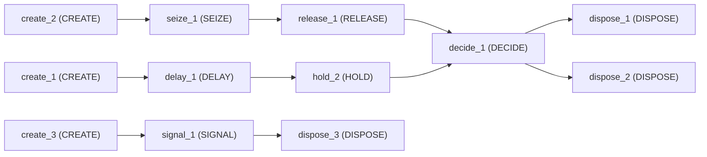
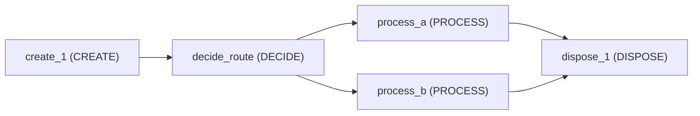
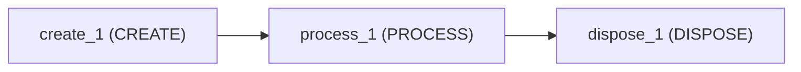
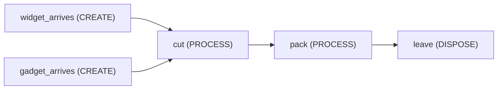

<!-- GENERATED by tools/gen_engine_docs.py -- do not edit by hand. -->
<!-- Regenerate with: python tools/gen_engine_docs.py -->

# Teaching

7 of the bundled models. The numbers are from a run made when this page was generated: see [how](index.md#how-the-numbers-are-made).

## Chance-based branching (DECIDE)

A CREATE feeding a DECIDE that splits arrivals 30/70 between a fast and a slow DELAY path -- the minimal example of chance-based branching.

```console
naga run decide_routing
```



3 replications, seed 0:

| KPI | Mean | 95% half-width |
|---|---|---|
| `system/Total Entities Completed` | 505 | 40 |
| `system/Avg Throughput Time` | 2.16 | 0.051 |

## HOLD on a store's contents

Trucks wait in a HOLD until two cases are staged at a packer. Cases arrive four at a time and are packed in threes, so the staged count rises and falls within one instant: the HOLD reads NS("pack") and is re-evaluated when the store changes, not on a timer.

```console
naga run hold_on_store
```



2 replications, seed 0:

| KPI | Mean | 95% half-width |
|---|---|---|
| `system/Total Entities Completed` | 29 | 0 |
| `system/Avg Throughput Time` | 3.34 | 0 |

## Delay, seize/release and signal HOLD

Three independent flows in one model: a plain delay chain, a SEIZE/RELEASE pair, and a HOLD gated by a SIGNAL -- demonstrates resource seizing and signal-based synchronization side by side.

```console
naga run hold_signal_flow
```



2 replications, seed 0:

| KPI | Mean | 95% half-width |
|---|---|---|
| `system/Total Entities Completed` | 30 | 0 |
| `system/Avg Throughput Time` | 1.72 | 0.6 |
| `system/Avg Queue Length` | 0.656 | 0.052 |
| `system/Avg Resource Usage %` | 51.2 | 69 |

## Policy-routed parallel servers

Arrivals routed by a Policy-mode DECIDE ('routing') between a fast and a slow single server; observation is each server's queue length and in-service flag. With no controller attached it falls back to always routing to ServerA (fallback 'first'), so the model runs headless with no RL involved.

```console
naga run parallel_routing_policy
```



1 replication, seed 0:

| KPI | Mean | 95% half-width |
|---|---|---|
| `system/Total Entities Completed` | 2,980 |  |
| `system/Avg Throughput Time` | 1.89 |  |
| `system/Avg Queue Length` | 2.09 |  |
| `system/Avg Resource Usage %` | 73.8 |  |

## Single server (M/M/1)

The classic M/M/1 queue: a single Server processes arriving customers one at a time -- the baseline example for utilization and waiting-time KPIs.

```console
naga run single_server --replications 3
```



3 replications, seed 0:

| KPI | Mean | 95% half-width |
|---|---|---|
| `system/Total Entities Completed` | 882 | 31 |
| `system/Avg Throughput Time` | 3.2 | 1.2 |
| `system/Avg Queue Length` | 2.39 | 1.2 |
| `system/Avg Resource Usage %` | 76.5 | 6.3 |

## Process time lookup table

Process time by product and station, read from a 2-D lookup table. Deterministic on purpose: one WIDGET and one GADGET (entity types are upper-cased by the engine, so the table's keys are too), far enough apart that neither ever queues, so every KPI is exact by hand.

```console
naga run table_process_times
```



1 replication, seed 0:

| KPI | Mean | 95% half-width |
|---|---|---|
| `system/Total Entities Completed` | 2 |  |
| `system/Avg Throughput Time` | 7.5 |  |
| `system/Avg Queue Length` | 0 |  |
| `system/Avg Resource Usage %` | 6.82 |  |

## Two tellers (resource set)

Customers served by either of two named tellers (TellerA/TellerB) through one PROCESS block -- the minimal example of a resource set with a selection rule.

```console
naga run two_teller_set --replications 3
```


3 replications, seed 0:

| KPI | Mean | 95% half-width |
|---|---|---|
| `system/Total Entities Completed` | 2,660 | 69 |
| `system/Avg Throughput Time` | 2.16 | 0.38 |
| `system/Avg Queue Length` | 1.72 | 0.56 |
| `system/Avg Resource Usage %` | 73.5 | 2.4 |
