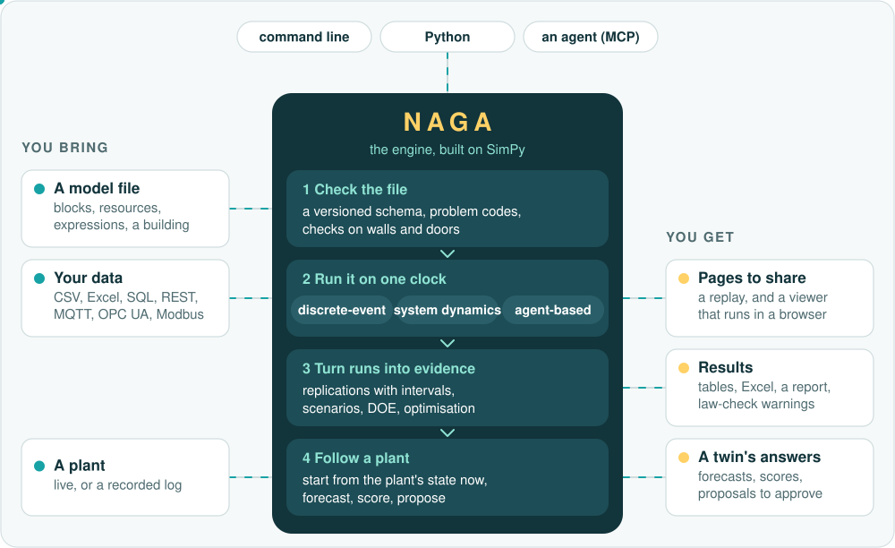

# Naga

Naga is a simulation engine for Python, built on [SimPy](https://simpy.readthedocs.io/). A model
is a JSON file, written by hand, by an agent or from Python code (`nagasim.build`): blocks
(create, process, seize, batch, decide, transport, ...) joined by links,
with resources, schedules, failures and costs. The engine runs it for a number of replications
and returns the statistics as pandas frames, with confidence intervals. The same file can also
hold stocks and flows (system dynamics), rate-based quantities such as tanks and batteries, and
populations of agents, all on one clock. An MCP server offers the same operations to an LLM agent.



```console
pip install nagasim
naga --help
```

Python 3.11 or later. It depends on SimPy, NumPy, pandas, SciPy and openpyxl.

## What's new in 0.9

--8<-- "docs/whats-new.md:latest"

All releases: [What's new](whats-new.md) for the highlights, [Release notes](changelog.md) for
every change.

## What it is not

- **Not an editor.** There is no window, no canvas and no animation here. `naga run --player`
  writes one HTML file that replays a run in a browser, and `naga viewer` one in which a reader
  re-runs the model; those are the only pictures.
- **Not SimPy with helpers.** You do not write generator functions. A model is data, even when
  Python code builds it, and what a block can do is fixed by its type and its expressions. When the logic you need is not a block,
  raw SimPy is the better tool: see [Coming from SimPy](coming-from/simpy.md).
- **Not stable yet.** Before 1.0 the Python API may change between minor versions. Model files
  always migrate forward, and agent tool names and problem codes are permanent.

## Where to go

| You want to | Read |
|---|---|
| run something in a minute | [Quick start](quickstart.md) |
| see what a model looks like and what it gives | [Gallery](gallery/index.md) |
| check the engine against models with a known answer | [Reference models](reference-models.md) |
| map what you know onto this | Coming from [SimPy](coming-from/simpy.md), [Arena](coming-from/arena.md), [AnyLogic](coming-from/anylogic.md), [Vensim](coming-from/vensim.md), [NetLogo](coming-from/netlogo.md) |
| write a model file | [Model file format](model-file-format.md), [Blocks](reference/blocks.md) |
| know what a part of a model does when it runs | [Modelling guide](modelling-guide/index.md) |
| compare, search and check models | [Experiments](experiments.md), [Model assertions](model-assertions.md), [Semantic diff](semantic-diff.md) |
| call it from a script or a notebook | [Python API](python-api.md) |
| let an agent build and run models | [Use with an agent](mcp.md) |
| give someone a model they can run in a browser | [Sharing a model](sharing-a-model.md) |
| follow a plant and forecast from its state | [Digital twin](digital-twin.md) |
| know what a model file can and cannot do to your machine | [Security](security.md) |

An LLM agent reading this site can start from [`llms.txt`](llms.txt).

Apache License 2.0. Source and issues: [github.com/TheMattHub/naga](https://github.com/TheMattHub/naga).
