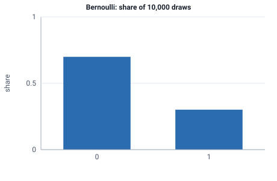

<!-- GENERATED by tools/gen_engine_docs.py -- do not edit by hand. -->
<!-- Regenerate with: python tools/gen_engine_docs.py -->

# Bernoulli

A single yes/no outcome with a given probability, such as accept or reject, pass or fail, or rework or not.  
Param: p (success probability) in [0, 1].

Category: special. Arrival: no. Delay: no. Support lower bound: 0.0.

## Parameters

| Parameter | Default | Hint |
|---|---|---|
| `p` | `0.5` | success probability, in [0, 1] |

## Draws

With p=0.3, 10,000 draws from a stream seeded 0:

| Mean (formula) | Mean of the draws | Variance of the draws |
|---|---|---|
| 0.3 | 0.301 | 0.21 |



## Example

In a model file, on any block or section that takes a duration:

```json
{"distribution": "Bernoulli", "dist_params": {"p": 0.3}}
```

In the Python builder:

```python
nb.Bernoulli(p=0.3)
```

## Used in

Guides: [How do I count the defects in a batch?](../../how-to/recipes/binomial-defects.md).

## See also

- [All distributions](index.md), [Expression functions](../functions/index.md), [Model file format](../../model-file-format.md)
