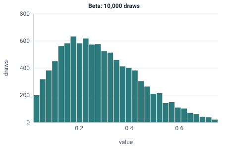

<!-- GENERATED by tools/gen_engine_docs.py -- do not edit by hand. -->
<!-- Regenerate with: python tools/gen_engine_docs.py -->

# Beta

A value between a minimum and a maximum with a flexible shape, such as a fraction, a proportion or a bounded time.  
Params: alpha, beta > 0; min < max.

Category: continuous. Arrival: yes. Delay: yes. Support lower bound: 0.0. Can be fit from data as `Beta` (see Input analysis).

## Parameters

| Parameter | Default | Hint |
|---|---|---|
| `min` | `0.0` | lower bound, < max |
| `max` | `1.0` | upper bound, > min |
| `alpha` | `1.0` | shape, > 0 |
| `beta` | `1.0` | shape, > 0 |

## Draws

With min=0, max=1, alpha=2, beta=5, 10,000 draws from a stream seeded 0:

| Mean (formula) | Mean of the draws | Variance of the draws |
|---|---|---|
| 0.286 | 0.286 | 0.0252 |



## Example

In a model file, on any block or section that takes a duration:

```json
{"distribution": "Beta", "dist_params": {"min": 0, "max": 1, "alpha": 2, "beta": 5}}
```

In the Python builder:

```python
nb.Beta(min=0, max=1, alpha=2, beta=5)
```

## Used in

No bundled model or guide uses it yet.

## See also

- [All distributions](index.md), [Expression functions](../functions/index.md), [Model file format](../../model-file-format.md)
