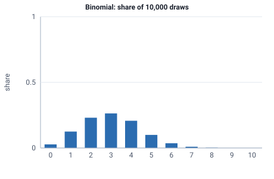

<!-- GENERATED by tools/gen_engine_docs.py -- do not edit by hand. -->
<!-- Regenerate with: python tools/gen_engine_docs.py -->

# Binomial

Count of successes (for example defective parts) in a fixed number of independent trials.  
Params: n (trials) >= 0, p in [0, 1].

Category: special. Arrival: no. Delay: no. Support lower bound: 0.0. Can be fit from data as `Binomial` (see Input analysis).

## Parameters

| Parameter | Default | Hint |
|---|---|---|
| `n` | `1.0` | number of trials, >= 0 |
| `p` | `0.5` | success probability, in [0, 1] |

## Draws

With n=10, p=0.3, 10,000 draws from a stream seeded 0:

| Mean (formula) | Mean of the draws | Variance of the draws |
|---|---|---|
| 3 | 3 | 2.11 |



## Example

In a model file, on any block or section that takes a duration:

```json
{"distribution": "Binomial", "dist_params": {"n": 10, "p": 0.3}}
```

In the Python builder:

```python
nb.Binomial(n=10, p=0.3)
```

## Used in

Guides: [How do I count the defects in a batch?](../../how-to/recipes/binomial-defects.md), [How do I model inspecting a sample from a finite lot?](../../how-to/recipes/lot-sample.md).

## See also

- [All distributions](index.md), [Expression functions](../functions/index.md), [Model file format](../../model-file-format.md)
