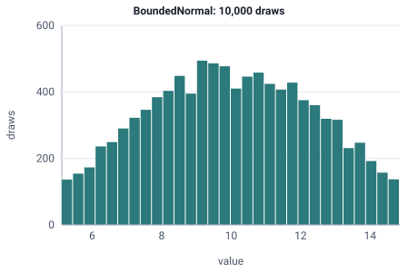

<!-- GENERATED by tools/gen_engine_docs.py -- do not edit by hand. -->
<!-- Regenerate with: python tools/gen_engine_docs.py -->

# BoundedNormal

Bell-shaped variation around an average, cut off at a minimum and a maximum so a time cannot go negative or beyond a physical limit.  
Params: mean (central value), stddev (standard deviation) > 0; min < max.

Category: special. Arrival: no. Delay: yes. Support lower bound: 0.0.

## Parameters

| Parameter | Default | Hint |
|---|---|---|
| `mean` | `0.0` | central value |
| `stddev` | `1.0` | standard deviation, > 0 |
| `min` | `0.0` | lower bound, < max |
| `max` | `1.0` | upper bound, > min |

## Draws

With mean=10, stddev=3, min=5, max=15, 10,000 draws from a stream seeded 0:

| Mean (formula) | Mean of the draws | Variance of the draws |
|---|---|---|
| 10 | 10 | 5.73 |



## Example

In a model file, on any block or section that takes a duration:

```json
{"distribution": "BoundedNormal", "dist_params": {"mean": 10, "stddev": 3, "min": 5, "max": 15}}
```

In the Python builder:

```python
nb.BoundedNormal(mean=10, stddev=3, min=5, max=15)
```

## Used in

Guides: [How do I stop a cycle time from going negative?](../../how-to/recipes/bounded-cycle.md).

## See also

- [All distributions](index.md), [Expression functions](../functions/index.md), [Model file format](../../model-file-format.md)
