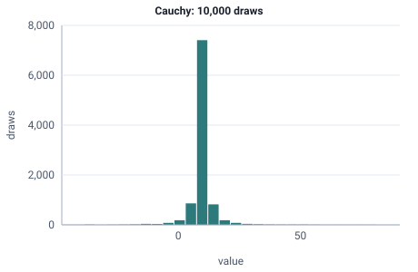

<!-- GENERATED by tools/gen_engine_docs.py -- do not edit by hand. -->
<!-- Regenerate with: python tools/gen_engine_docs.py -->

# Cauchy

Very heavy-tailed values with frequent extreme outliers in both directions; rarely right for times, and it often returns negative values.  
Params: x0 (location), gamma (scale) > 0.

Category: special. Arrival: no. Delay: no. Support lower bound: unbounded.

## Parameters

| Parameter | Default | Hint |
|---|---|---|
| `x0` | `0.0` | location |
| `gamma` | `1.0` | scale, > 0 |

## Draws

With x0=10, gamma=1, 10,000 draws from a stream seeded 0:

| Mean (formula) | Mean of the draws | Variance of the draws |
|---|---|---|
| none: the mean is not finite | 19.9 | 974,000 |

With no finite mean the average of draws does not settle; another seed gives another value.



## Example

In a model file, on any block or section that takes a duration:

```json
{"distribution": "Cauchy", "dist_params": {"x0": 10, "gamma": 1}}
```

In the Python builder:

```python
nb.Cauchy(x0=10, gamma=1)
```

## Used in

Guides: [What happens to a queue when service times have wild outliers?](../../how-to/recipes/wild-outliers.md).

## See also

- [All distributions](index.md), [Expression functions](../functions/index.md), [Model file format](../../model-file-format.md)
