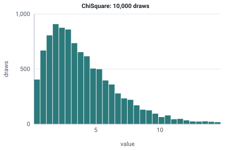

<!-- GENERATED by tools/gen_engine_docs.py -- do not edit by hand. -->
<!-- Regenerate with: python tools/gen_engine_docs.py -->

# ChiSquare

Statistical diagnostics and sums of squared normal variations; rarely used for simulation times.  
Param: df (degrees of freedom) >= 1.

Category: special. Arrival: no. Delay: no. Support lower bound: 0.0.

## Parameters

| Parameter | Default | Hint |
|---|---|---|
| `df` | `1.0` | degrees of freedom, >= 1 |

## Draws

With df=4, 10,000 draws from a stream seeded 0:

| Mean (formula) | Mean of the draws | Variance of the draws |
|---|---|---|
| 4 | 4.04 | 8.05 |



## Example

In a model file, on any block or section that takes a duration:

```json
{"distribution": "ChiSquare", "dist_params": {"df": 4}}
```

In the Python builder:

```python
nb.ChiSquare(df=4)
```

## Used in

Guides: [How do I model a correction time that grows with a positioning error?](../../how-to/recipes/positioning-error.md).

## See also

- [All distributions](index.md), [Expression functions](../functions/index.md), [Model file format](../../model-file-format.md)
