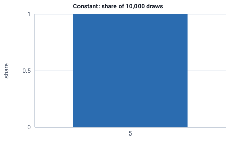

<!-- GENERATED by tools/gen_engine_docs.py -- do not edit by hand. -->
<!-- Regenerate with: python tools/gen_engine_docs.py -->

# Constant

A fixed duration that never varies, for a deterministic service time, transit time or interval.  
Params: value (fixed duration) >= 0.

Category: continuous. Arrival: yes. Delay: yes. Support lower bound: 0.0.

## Parameters

| Parameter | Default | Hint |
|---|---|---|
| `value` | `1.0` | fixed duration, >= 0 |

## Draws

With value=5, 10,000 draws from a stream seeded 0:

| Mean (formula) | Mean of the draws | Variance of the draws |
|---|---|---|
| 5 | 5 | 0 |



## Example

In a model file, on any block or section that takes a duration:

```json
{"distribution": "Constant", "dist_params": {"value": 5}}
```

In the Python builder:

```python
nb.Constant(value=5)
```

## Used in

Bundled models: [Biogas digester, holder and CHP](../../gallery/energy.md), [Chance-based branching (DECIDE)](../../gallery/teaching.md).

Guides: [Python API](../../python-api.md), [How do I write a plugin block?](../../goals/write-a-plugin-block.md), [How do I model handling times with an occasional very long one?](../../how-to/recipes/lognormal-tail.md), [How do I run arrivals from a fixed timetable?](../../how-to/recipes/timetable-arrivals.md), [How do I model a machine that wears out?](../../how-to/recipes/weibull-wear-out.md), [Model file format](../../model-file-format.md).

## See also

- [All distributions](index.md), [Expression functions](../functions/index.md), [Model file format](../../model-file-format.md)
