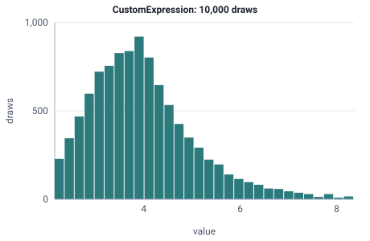

<!-- GENERATED by tools/gen_engine_docs.py -- do not edit by hand. -->
<!-- Regenerate with: python tools/gen_engine_docs.py -->

# CustomExpression

Any model expression, for example '2 + EXPO(3)', when no single distribution fits.  
Param: expression (string, e.g. '2 + EXPO(3)').

Category: continuous. Arrival: yes. Delay: yes. Support lower bound: 0.0.

## Parameters

| Parameter | Default | Hint |
|---|---|---|
| `expression` | `'1'` | model expression, e.g. '2 + EXPO(3)' |

## Draws

With expression='UNIF(2, 4) + EXPO(1)', 10,000 draws from a stream seeded 0:

| Mean of the draws | Variance of the draws |
|---|---|
| 4 | 1.29 |



## Example

In a model file, on any block or section that takes a duration:

```json
{"distribution": "CustomExpression", "dist_params": {"expression": "UNIF(2, 4) + EXPO(1)"}}
```

In the Python builder:

```python
nb.CustomExpression(expression='UNIF(2, 4) + EXPO(1)')
```

## Used in

Guides: [How do I model a time that is a fixed part plus a random part?](../../how-to/recipes/formula-time.md), [How do I combine event flow, system dynamics and agents?](../../goals/hybrid-model.md), [Expressions and variables](../../modelling-guide/expressions-variables.md).

## See also

- [All distributions](index.md), [Expression functions](../functions/index.md), [Model file format](../../model-file-format.md)
