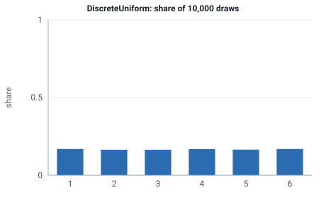

<!-- GENERATED by tools/gen_engine_docs.py -- do not edit by hand. -->
<!-- Regenerate with: python tools/gen_engine_docs.py -->

# DiscreteUniform

A whole number between a minimum and a maximum, each equally likely, such as a random lot size from 1 to 6.  
Params: low (min) <= high (max), integers.

Category: special. Arrival: no. Delay: yes. Support lower bound: 0.0. Can be fit from data as `DiscreteUniform` (see Input analysis).

## Parameters

| Parameter | Default | Hint |
|---|---|---|
| `low` | `0.0` | minimum integer, <= high |
| `high` | `1.0` | maximum integer, >= low |

## Draws

With low=1, high=6, 10,000 draws from a stream seeded 0:

| Mean (formula) | Mean of the draws | Variance of the draws |
|---|---|---|
| 3.5 | 3.5 | 2.94 |



## Example

In a model file, on any block or section that takes a duration:

```json
{"distribution": "DiscreteUniform", "dist_params": {"low": 1, "high": 6}}
```

In the Python builder:

```python
nb.DiscreteUniform(low=1, high=6)
```

## Used in

Guides: [How do I draw order sizes from my own data?](../../how-to/recipes/order-sizes.md).

## See also

- [All distributions](index.md), [Expression functions](../functions/index.md), [Model file format](../../model-file-format.md)
