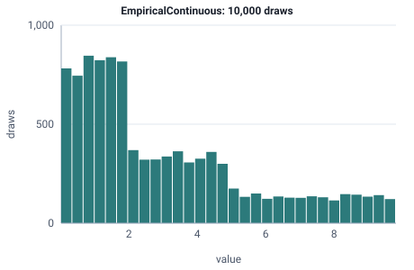

<!-- GENERATED by tools/gen_engine_docs.py -- do not edit by hand. -->
<!-- Regenerate with: python tools/gen_engine_docs.py -->

# EmpiricalContinuous

Measured data as a histogram: a bin is picked by its weight, then a value is drawn evenly within it (a continuous draw, not a resample of points).  
Params: values (float list of bin edges, length = len(probs) + 1), probs (bin weights summing to 1).

Category: continuous. Arrival: yes. Delay: yes. Support lower bound: 0.0.

## Parameters

| Parameter | Default | Hint |
|---|---|---|
| `values` | `[0.0, 1.0]` | bin edges, length = len(probs) + 1 |
| `probs` | `[1.0]` | bin weights, summing to 1 |

## Draws

With values=[0, 2, 5, 10], probs=[0.5, 0.3, 0.2], 10,000 draws from a stream seeded 0:

| Mean (formula) | Mean of the draws | Variance of the draws |
|---|---|---|
| 3.05 | 3.07 | 6.84 |



## Example

In a model file, on any block or section that takes a duration:

```json
{"distribution": "EmpiricalContinuous", "dist_params": {"values": [0, 2, 5, 10], "probs": [0.5, 0.3, 0.2]}}
```

In the Python builder:

```python
nb.EmpiricalContinuous(values=[0, 2, 5, 10], probs=[0.5, 0.3, 0.2])
```

## Used in

Guides: [How do I use a histogram from a time study as a service time?](../../how-to/recipes/histogram-times.md).

## See also

- [All distributions](index.md), [Expression functions](../functions/index.md), [Model file format](../../model-file-format.md)
