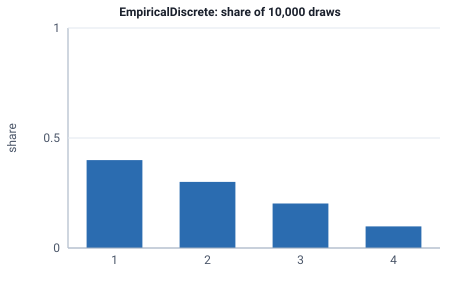

<!-- GENERATED by tools/gen_engine_docs.py -- do not edit by hand. -->
<!-- Regenerate with: python tools/gen_engine_docs.py -->

# EmpiricalDiscrete

Whole-number values with their own measured probabilities, such as order sizes or the number of items per job.  
Params: values (int list), probs (weights summing to 1).

Category: discrete. Arrival: yes. Delay: yes. Support lower bound: 0.0.

## Parameters

| Parameter | Default | Hint |
|---|---|---|
| `values` | `[0]` | candidate integer values |
| `probs` | `[1.0]` | weight per value, summing to 1 |

## Draws

With values=[1, 2, 3, 4], probs=[0.4, 0.3, 0.2, 0.1], 10,000 draws from a stream seeded 0:

| Mean (formula) | Mean of the draws | Variance of the draws |
|---|---|---|
| 2 | 2 | 0.994 |



## Example

In a model file, on any block or section that takes a duration:

```json
{"distribution": "EmpiricalDiscrete", "dist_params": {"values": [1, 2, 3, 4], "probs": [0.4, 0.3, 0.2, 0.1]}}
```

In the Python builder:

```python
nb.EmpiricalDiscrete(values=[1, 2, 3, 4], probs=[0.4, 0.3, 0.2, 0.1])
```

An expression has its own call for it: `DISC(value1, prob1, value2, prob2, ...)`.

## Used in

Guides: [How do I draw order sizes from my own data?](../../how-to/recipes/order-sizes.md).

## See also

- [All distributions](index.md), [Expression functions](../functions/index.md), [Model file format](../../model-file-format.md)
