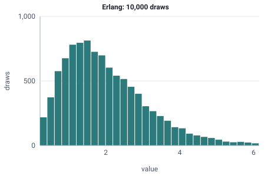

<!-- GENERATED by tools/gen_engine_docs.py -- do not edit by hand. -->
<!-- Regenerate with: python tools/gen_engine_docs.py -->

# Erlang

Time to finish k exponential steps in a row, giving a service time less variable than exponential but still random.  
Params: k (stages) >= 1, rate (lambda) > 0.

Category: continuous. Arrival: yes. Delay: yes. Support lower bound: 0.0. Can be fit from data as `Erlang` (see Input analysis).

## Parameters

| Parameter | Default | Hint |
|---|---|---|
| `k` | `1.0` | number of exponential stages, >= 1 |
| `rate` | `1.0` | lambda, > 0 |

## Draws

With k=3, rate=1.5, 10,000 draws from a stream seeded 0:

| Mean (formula) | Mean of the draws | Variance of the draws |
|---|---|---|
| 2 | 2.02 | 1.34 |



## Example

In a model file, on any block or section that takes a duration:

```json
{"distribution": "Erlang", "dist_params": {"k": 3, "rate": 1.5}}
```

In the Python builder:

```python
nb.Erlang(k=3, rate=1.5)
```

## Used in

Guides: [How do I model a job made of several short steps?](../../how-to/recipes/erlang-steps.md), [How do I fit input distributions from data?](../../goals/fit-input-distributions.md).

## See also

- [All distributions](index.md), [Expression functions](../functions/index.md), [Model file format](../../model-file-format.md)
