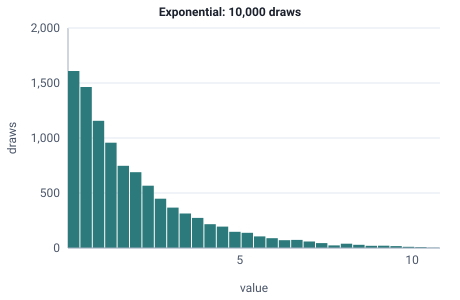

<!-- GENERATED by tools/gen_engine_docs.py -- do not edit by hand. -->
<!-- Regenerate with: python tools/gen_engine_docs.py -->

# Exponential

Time between random independent arrivals, or time to a random breakdown, when past events do not change the next one.  
Param: rate (lambda, event rate) > 0.

Category: continuous. Arrival: yes. Delay: yes. Support lower bound: 0.0. Can be fit from data as `Exponential` (see Input analysis).

## Parameters

| Parameter | Default | Hint |
|---|---|---|
| `rate` | `1.0` | event rate (lambda), > 0 |

## Draws

With rate=0.5, 10,000 draws from a stream seeded 0:

| Mean (formula) | Mean of the draws | Variance of the draws |
|---|---|---|
| 2 | 1.99 | 3.98 |



## Example

In a model file, on any block or section that takes a duration:

```json
{"distribution": "Exponential", "dist_params": {"rate": 0.5}}
```

In the Python builder:

```python
nb.Exponential(rate=0.5)
```

An expression has its own call for it: `EXPO(mean)`.

## Used in

Bundled models: [Biogas plant (library assets)](../../gallery/energy.md), [Emergency department: staffing game](../../gallery/games.md), [Warehouse with forklifts (floor plan)](../../gallery/logistics.md), [Robot cell against manual assembly](../../gallery/manufacturing.md), [Job shop (Jackson network)](../../gallery/manufacturing.md), [Job shop (routed, per-product sequences)](../../gallery/manufacturing.md) and 18 more.

Guides: [Python API](../../python-api.md), [Quick start](../../quickstart.md), [Coming from salabim](../../coming-from/salabim.md), [Coming from SimPy](../../coming-from/simpy.md), [How do I fit input distributions from data?](../../goals/fit-input-distributions.md), [Use with an agent](../../mcp.md) and 25 more.

## See also

- [All distributions](index.md), [Expression functions](../functions/index.md), [Model file format](../../model-file-format.md)
