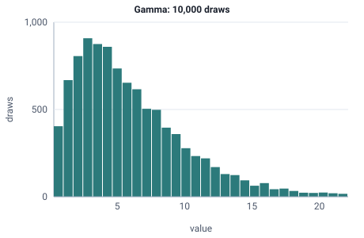

<!-- GENERATED by tools/gen_engine_docs.py -- do not edit by hand. -->
<!-- Regenerate with: python tools/gen_engine_docs.py -->

# Gamma

Right-skewed service or processing times that cannot go below zero, from very regular to very variable.  
Params: alpha (shape) > 0, beta (scale) > 0.

Category: continuous. Arrival: yes. Delay: yes. Support lower bound: 0.0. Can be fit from data as `Gamma` (see Input analysis).

## Parameters

| Parameter | Default | Hint |
|---|---|---|
| `alpha` | `1.0` | shape, > 0 |
| `beta` | `1.0` | scale, > 0 |

## Draws

With alpha=2, beta=3, 10,000 draws from a stream seeded 0:

| Mean (formula) | Mean of the draws | Variance of the draws |
|---|---|---|
| 6 | 6.06 | 18.1 |



## Example

In a model file, on any block or section that takes a duration:

```json
{"distribution": "Gamma", "dist_params": {"alpha": 2, "beta": 3}}
```

In the Python builder:

```python
nb.Gamma(alpha=2, beta=3)
```

## Used in

No bundled model or guide uses it yet.

## See also

- [All distributions](index.md), [Expression functions](../functions/index.md), [Model file format](../../model-file-format.md)
