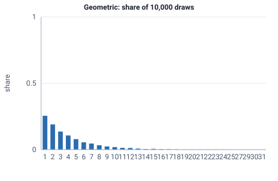

<!-- GENERATED by tools/gen_engine_docs.py -- do not edit by hand. -->
<!-- Regenerate with: python tools/gen_engine_docs.py -->

# Geometric

Number of attempts until the first success, such as tries before a part passes inspection.  
Param: p in (0, 1].

Category: special. Arrival: no. Delay: no. Support lower bound: 0.0. Can be fit from data as `Geometric` (see Input analysis).

## Parameters

| Parameter | Default | Hint |
|---|---|---|
| `p` | `0.5` | success probability, in (0, 1] |

## Draws

With p=0.25, 10,000 draws from a stream seeded 0:

| Mean (formula) | Mean of the draws | Variance of the draws |
|---|---|---|
| 4 | 3.98 | 12 |



## Example

In a model file, on any block or section that takes a duration:

```json
{"distribution": "Geometric", "dist_params": {"p": 0.25}}
```

In the Python builder:

```python
nb.Geometric(p=0.25)
```

## Used in

Guides: [How do I model retesting until a part passes?](../../how-to/recipes/retest-attempts.md), [How do I fit input distributions from data?](../../goals/fit-input-distributions.md).

## See also

- [All distributions](index.md), [Expression functions](../functions/index.md), [Model file format](../../model-file-format.md)
