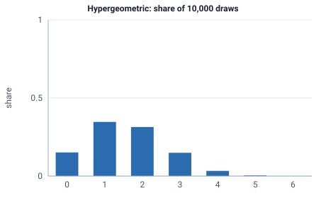

<!-- GENERATED by tools/gen_engine_docs.py -- do not edit by hand. -->
<!-- Regenerate with: python tools/gen_engine_docs.py -->

# Hypergeometric

Successes in a sample drawn without replacement from a finite lot, such as defectives found when inspecting a sample.  
Params: N (population) >= K (success states) >= n (sample) >= 0.

Category: special. Arrival: no. Delay: no. Support lower bound: 0.0.

## Parameters

| Parameter | Default | Hint |
|---|---|---|
| `N` | `10.0` | population size |
| `K` | `5.0` | number of success states in the population |
| `n` | `3.0` | sample size |

## Draws

With N=50, K=10, n=8, 10,000 draws from a stream seeded 0:

| Mean (formula) | Mean of the draws | Variance of the draws |
|---|---|---|
| 1.6 | 1.58 | 1.11 |



## Example

In a model file, on any block or section that takes a duration:

```json
{"distribution": "Hypergeometric", "dist_params": {"N": 50, "K": 10, "n": 8}}
```

In the Python builder:

```python
nb.Hypergeometric(N=50, K=10, n=8)
```

## Used in

Guides: [How do I model inspecting a sample from a finite lot?](../../how-to/recipes/lot-sample.md).

## See also

- [All distributions](index.md), [Expression functions](../functions/index.md), [Model file format](../../model-file-format.md)
