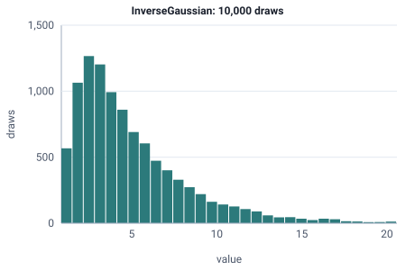

<!-- GENERATED by tools/gen_engine_docs.py -- do not edit by hand. -->
<!-- Regenerate with: python tools/gen_engine_docs.py -->

# InverseGaussian

Right-skewed positive times such as a reaction or decision delay, or the time for a drifting quantity to reach a level.  
Params: mu (mean) > 0, lambda (shape) > 0.

Category: continuous. Arrival: yes. Delay: yes. Support lower bound: 0.0. Can be fit from data as `InverseGaussian` (see Input analysis).

## Parameters

| Parameter | Default | Hint |
|---|---|---|
| `mu` | `1.0` | mean, > 0 |
| `lambda` | `1.0` | shape, > 0 |

## Draws

With mu=5, lambda=10, 10,000 draws from a stream seeded 0:

| Mean (formula) | Mean of the draws | Variance of the draws |
|---|---|---|
| 5 | 5.02 | 12.4 |



## Example

In a model file, on any block or section that takes a duration:

```json
{"distribution": "InverseGaussian", "dist_params": {"mu": 5, "lambda": 10}}
```

In the Python builder:

```python
nb.InverseGaussian(mu=5, lambda_=10)
```

## Used in

Guides: [How do I model an approval or reaction time that is never negative?](../../how-to/recipes/decision-delay.md), [How do I fit input distributions from data?](../../goals/fit-input-distributions.md).

## See also

- [All distributions](index.md), [Expression functions](../functions/index.md), [Model file format](../../model-file-format.md)
