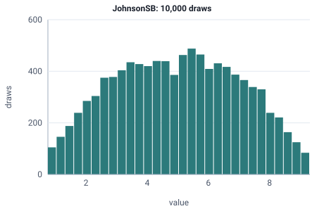

<!-- GENERATED by tools/gen_engine_docs.py -- do not edit by hand. -->
<!-- Regenerate with: python tools/gen_engine_docs.py -->

# JohnsonSB

A skewed value that stays between a minimum and a maximum, such as a yield or fill percentage.  
Params: a1, a2 (shape), min < max.

Category: special. Arrival: no. Delay: no. Support lower bound: 0.0.

## Parameters

| Parameter | Default | Hint |
|---|---|---|
| `a1` | `0.0` | shape |
| `a2` | `1.0` | shape |
| `min` | `0.0` | lower bound, < max |
| `max` | `1.0` | upper bound, > min |

## Draws

With a1=0, a2=1, min=0, max=10, 10,000 draws from a stream seeded 0:

| Mean (formula) | Mean of the draws | Variance of the draws |
|---|---|---|
| 5 | 4.98 | 4.34 |



## Example

In a model file, on any block or section that takes a duration:

```json
{"distribution": "JohnsonSB", "dist_params": {"a1": 0, "a2": 1, "min": 0, "max": 10}}
```

In the Python builder:

```python
nb.JohnsonSB(a1=0, a2=1, min=0, max=10)
```

## Used in

Guides: [How do I keep a skewed time between a minimum and a maximum?](../../how-to/recipes/bounded-yield.md).

## See also

- [All distributions](index.md), [Expression functions](../functions/index.md), [Model file format](../../model-file-format.md)
