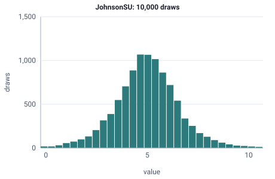

<!-- GENERATED by tools/gen_engine_docs.py -- do not edit by hand. -->
<!-- Regenerate with: python tools/gen_engine_docs.py -->

# JohnsonSU

A flexible fit for skewed, heavy-tailed data when no simple distribution matches; it can return negative values.  
Params: a, b (shape), loc (center), scale > 0.

Category: special. Arrival: no. Delay: no. Support lower bound: unbounded.

## Parameters

| Parameter | Default | Hint |
|---|---|---|
| `a` | `0.0` | shape |
| `b` | `1.0` | shape |
| `loc` | `0.0` | center |
| `scale` | `1.0` | scale, > 0 |

## Draws

With a=0, b=1.5, loc=5, scale=2, 10,000 draws from a stream seeded 0:

| Mean (formula) | Mean of the draws | Variance of the draws |
|---|---|---|
| 5 | 5 | 2.91 |



## Example

In a model file, on any block or section that takes a duration:

```json
{"distribution": "JohnsonSU", "dist_params": {"a": 0, "b": 1.5, "loc": 5, "scale": 2}}
```

In the Python builder:

```python
nb.JohnsonSU(a=0, b=1.5, loc=5, scale=2)
```

## Used in

Guides: [How do I keep a skewed time between a minimum and a maximum?](../../how-to/recipes/bounded-yield.md).

## See also

- [All distributions](index.md), [Expression functions](../functions/index.md), [Model file format](../../model-file-format.md)
