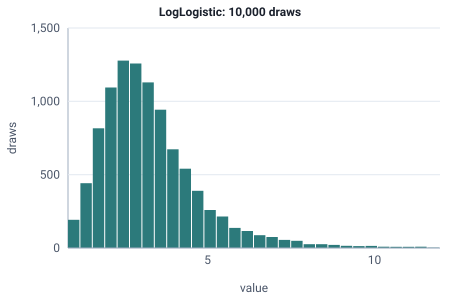

<!-- GENERATED by tools/gen_engine_docs.py -- do not edit by hand. -->
<!-- Regenerate with: python tools/gen_engine_docs.py -->

# LogLogistic

Right-skewed durations with a heavier tail than lognormal, such as repair or lifetime data that cannot go below zero.  
Params: c (shape) > 0, scale > 0.

Category: continuous. Arrival: yes. Delay: yes. Support lower bound: 0.0. Can be fit from data as `LogLogistic` (see Input analysis).

## Parameters

| Parameter | Default | Hint |
|---|---|---|
| `c` | `1.0` | shape, > 0 |
| `scale` | `1.0` | scale, > 0 |

## Draws

With c=4, scale=3, 10,000 draws from a stream seeded 0:

| Mean (formula) | Mean of the draws | Variance of the draws |
|---|---|---|
| 3.33 | 3.34 | 3.5 |



## Example

In a model file, on any block or section that takes a duration:

```json
{"distribution": "LogLogistic", "dist_params": {"c": 4, "scale": 3}}
```

In the Python builder:

```python
nb.LogLogistic(c=4, scale=3)
```

## Used in

Guides: [How do I model repair times with a long tail?](../../how-to/recipes/repair-tail.md).

## See also

- [All distributions](index.md), [Expression functions](../functions/index.md), [Model file format](../../model-file-format.md)
