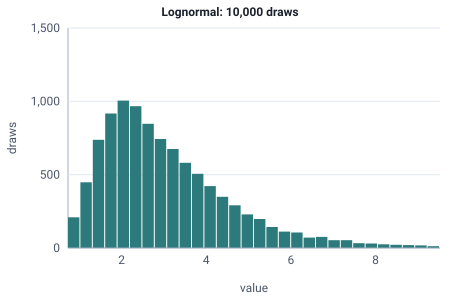

<!-- GENERATED by tools/gen_engine_docs.py -- do not edit by hand. -->
<!-- Regenerate with: python tools/gen_engine_docs.py -->

# Lognormal

Right-skewed times that cannot go below zero, such as manual handling, picking or repair durations with an occasional long one.  
Params: mu (log-mean), sigma (log-stddev) > 0.

Category: continuous. Arrival: yes. Delay: yes. Support lower bound: 0.0. Can be fit from data as `Lognormal` (see Input analysis).

## Parameters

| Parameter | Default | Hint |
|---|---|---|
| `mu` | `0.0` | log-mean |
| `sigma` | `1.0` | log-stddev, > 0 |

## Draws

With mu=1, sigma=0.5, 10,000 draws from a stream seeded 0:

| Mean (formula) | Mean of the draws | Variance of the draws |
|---|---|---|
| 3.08 | 3.09 | 2.62 |



## Example

In a model file, on any block or section that takes a duration:

```json
{"distribution": "Lognormal", "dist_params": {"mu": 1, "sigma": 0.5}}
```

In the Python builder:

```python
nb.Lognormal(mu=1, sigma=0.5)
```

## Used in

Guides: [How do I model handling times with an occasional very long one?](../../how-to/recipes/lognormal-tail.md), [How do I fit input distributions from data?](../../goals/fit-input-distributions.md).

## See also

- [All distributions](index.md), [Expression functions](../functions/index.md), [Model file format](../../model-file-format.md)
