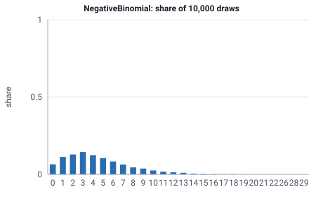

<!-- GENERATED by tools/gen_engine_docs.py -- do not edit by hand. -->
<!-- Regenerate with: python tools/gen_engine_docs.py -->

# NegativeBinomial

Number of failures before a set number of successes, each try with the same chance of success, such as rejected parts before r good ones.  
Params: r (target successes) >= 1, p in (0, 1].

Category: special. Arrival: no. Delay: no. Support lower bound: 0.0.

## Parameters

| Parameter | Default | Hint |
|---|---|---|
| `r` | `1.0` | target number of successes, >= 1 |
| `p` | `0.5` | success probability, in (0, 1] |

## Draws

With r=3, p=0.4, 10,000 draws from a stream seeded 0:

| Mean (formula) | Mean of the draws | Variance of the draws |
|---|---|---|
| 4.5 | 4.53 | 11.4 |



## Example

In a model file, on any block or section that takes a duration:

```json
{"distribution": "NegativeBinomial", "dist_params": {"r": 3, "p": 0.4}}
```

In the Python builder:

```python
nb.NegativeBinomial(r=3, p=0.4)
```

## Used in

Guides: [How do I model retesting until a part passes?](../../how-to/recipes/retest-attempts.md).

## See also

- [All distributions](index.md), [Expression functions](../functions/index.md), [Model file format](../../model-file-format.md)
