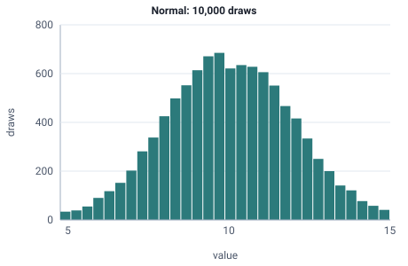

<!-- GENERATED by tools/gen_engine_docs.py -- do not edit by hand. -->
<!-- Regenerate with: python tools/gen_engine_docs.py -->

# Normal

Symmetric variation around an average, such as a cycle time that is rarely far from the mean; it can go negative unless the mean is much larger than the spread.  
Params: mean (central value), stddev (standard deviation) > 0.

Category: special. Arrival: no. Delay: no. Support lower bound: unbounded. Can be fit from data as `Normal` (see Input analysis).

## Parameters

| Parameter | Default | Hint |
|---|---|---|
| `mean` | `0.0` | central value |
| `stddev` | `1.0` | standard deviation, > 0 |

## Draws

With mean=10, stddev=2, 10,000 draws from a stream seeded 0:

| Mean (formula) | Mean of the draws | Variance of the draws |
|---|---|---|
| 10 | 10 | 3.99 |



## Example

In a model file, on any block or section that takes a duration:

```json
{"distribution": "Normal", "dist_params": {"mean": 10, "stddev": 2}}
```

In the Python builder:

```python
nb.Normal(mean=10, stddev=2)
```

An expression has its own call for it: `NORM(mean, sd)`.

## Used in

Guides: [How do I stop a cycle time from going negative?](../../how-to/recipes/bounded-cycle.md), [How do I fit input distributions from data?](../../goals/fit-input-distributions.md), [What happens to a queue when service times have wild outliers?](../../how-to/recipes/wild-outliers.md).

## See also

- [All distributions](index.md), [Expression functions](../functions/index.md), [Model file format](../../model-file-format.md)
