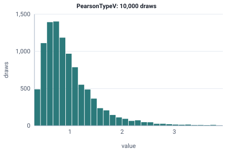

<!-- GENERATED by tools/gen_engine_docs.py -- do not edit by hand. -->
<!-- Regenerate with: python tools/gen_engine_docs.py -->

# PearsonTypeV

Right-skewed positive delays or times to failure with a long tail, an alternative to lognormal.  
Params: a (shape) > 0, scale > 0.

Category: continuous. Arrival: no. Delay: yes. Support lower bound: 0.0.

## Parameters

| Parameter | Default | Hint |
|---|---|---|
| `a` | `1.0` | shape, > 0 |
| `scale` | `1.0` | scale, > 0 |

## Draws

With a=5, scale=4, 10,000 draws from a stream seeded 0:

| Mean (formula) | Mean of the draws | Variance of the draws |
|---|---|---|
| 1 | 1 | 0.368 |



## Example

In a model file, on any block or section that takes a duration:

```json
{"distribution": "PearsonTypeV", "dist_params": {"a": 5, "scale": 4}}
```

In the Python builder:

```python
nb.PearsonTypeV(a=5, scale=4)
```

## Used in

Guides: [How do I model repair times with a long tail?](../../how-to/recipes/repair-tail.md).

## See also

- [All distributions](index.md), [Expression functions](../functions/index.md), [Model file format](../../model-file-format.md)
