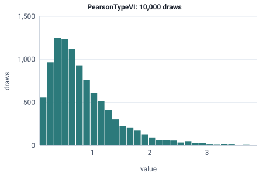

<!-- GENERATED by tools/gen_engine_docs.py -- do not edit by hand. -->
<!-- Regenerate with: python tools/gen_engine_docs.py -->

# PearsonTypeVI

A ratio of two gamma variables, such as cost per service, that is always positive; it can model times when the parameters suit.  
Params: a, b > 0, scale > 0.

Category: continuous. Arrival: no. Delay: yes. Support lower bound: 0.0.

## Parameters

| Parameter | Default | Hint |
|---|---|---|
| `a` | `1.0` | shape, > 0 |
| `b` | `1.0` | shape, > 0 |
| `scale` | `1.0` | scale, > 0 |

## Draws

With a=3, b=8, scale=2, 10,000 draws from a stream seeded 0:

| Mean (formula) | Mean of the draws | Variance of the draws |
|---|---|---|
| 0.857 | 0.856 | 0.428 |



## Example

In a model file, on any block or section that takes a duration:

```json
{"distribution": "PearsonTypeVI", "dist_params": {"a": 3, "b": 8, "scale": 2}}
```

In the Python builder:

```python
nb.PearsonTypeVI(a=3, b=8, scale=2)
```

## Used in

Guides: [How do I model repair times with a long tail?](../../how-to/recipes/repair-tail.md).

## See also

- [All distributions](index.md), [Expression functions](../functions/index.md), [Model file format](../../model-file-format.md)
