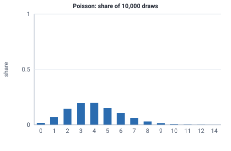

<!-- GENERATED by tools/gen_engine_docs.py -- do not edit by hand. -->
<!-- Regenerate with: python tools/gen_engine_docs.py -->

# Poisson

Counts per period, such as the number of arrivals or events in a fixed time window.  
Param: lambda (average rate) > 0.

Category: discrete. Arrival: yes. Delay: yes. Support lower bound: 0.0. Can be fit from data as `Poisson` (see Input analysis).

## Parameters

| Parameter | Default | Hint |
|---|---|---|
| `lambda` | `1.0` | average rate, > 0 |

## Draws

With lambda=4, 10,000 draws from a stream seeded 0:

| Mean (formula) | Mean of the draws | Variance of the draws |
|---|---|---|
| 4 | 4.02 | 3.99 |



## Example

In a model file, on any block or section that takes a duration:

```json
{"distribution": "Poisson", "dist_params": {"lambda": 4}}
```

In the Python builder:

```python
nb.Poisson(lambda_=4)
```

## Used in

Guides: [How do I model the number of lines on an order?](../../how-to/recipes/poisson-lines.md), [Coming from SimPy](../../coming-from/simpy.md), [Schedules, failures and the WAIT rule](../../modelling-guide/schedules-failures.md), [Python API](../../python-api.md).

## See also

- [All distributions](index.md), [Expression functions](../functions/index.md), [Model file format](../../model-file-format.md)
