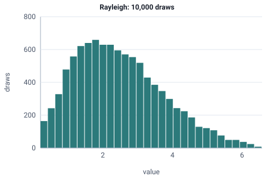

<!-- GENERATED by tools/gen_engine_docs.py -- do not edit by hand. -->
<!-- Regenerate with: python tools/gen_engine_docs.py -->

# Rayleigh

A positive magnitude such as movement noise or a positioning error, with a single scale parameter.  
Param: sigma (scale) > 0.

Category: continuous. Arrival: yes. Delay: yes. Support lower bound: 0.0. Can be fit from data as `Rayleigh` (see Input analysis).

## Parameters

| Parameter | Default | Hint |
|---|---|---|
| `sigma` | `1.0` | scale, > 0 |

## Draws

With sigma=2, 10,000 draws from a stream seeded 0:

| Mean (formula) | Mean of the draws | Variance of the draws |
|---|---|---|
| 2.51 | 2.5 | 1.71 |



## Example

In a model file, on any block or section that takes a duration:

```json
{"distribution": "Rayleigh", "dist_params": {"sigma": 2}}
```

In the Python builder:

```python
nb.Rayleigh(sigma=2)
```

## Used in

Guides: [How do I model a correction time that grows with a positioning error?](../../how-to/recipes/positioning-error.md).

## See also

- [All distributions](index.md), [Expression functions](../functions/index.md), [Model file format](../../model-file-format.md)
