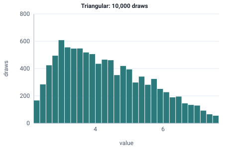

<!-- GENERATED by tools/gen_engine_docs.py -- do not edit by hand. -->
<!-- Regenerate with: python tools/gen_engine_docs.py -->

# Triangular

Min, most likely and max are known, usually from expert estimates when there is no data.  
Params: low =< mode =< high.

Category: continuous. Arrival: yes. Delay: yes. Support lower bound: 0.0. Can be fit from data as `Triangular` (see Input analysis).

## Parameters

| Parameter | Default | Hint |
|---|---|---|
| `low` | `0.0` | minimum, <= mode |
| `high` | `1.0` | maximum, >= mode |
| `mode` | `0.5` | most likely value, between low and high |

## Draws

With low=2, mode=3, high=8, 10,000 draws from a stream seeded 0:

| Mean (formula) | Mean of the draws | Variance of the draws |
|---|---|---|
| 4.33 | 4.33 | 1.72 |



## Example

In a model file, on any block or section that takes a duration:

```json
{"distribution": "Triangular", "dist_params": {"low": 2, "mode": 3, "high": 8}}
```

In the Python builder:

```python
nb.Triangular(low=2, mode=3, high=8)
```

An expression has its own call for it: `TRIA(low, mode, high)`.

## Used in

Bundled models: [Warehouse with forklifts (floor plan)](../../gallery/logistics.md), [Emergency department: bedside scan (film template)](../../gallery/services.md), [Chance-based branching (DECIDE)](../../gallery/teaching.md), [Delay, seize/release and signal HOLD](../../gallery/teaching.md).

Guides: [Python API](../../python-api.md).

## See also

- [All distributions](index.md), [Expression functions](../functions/index.md), [Model file format](../../model-file-format.md)
