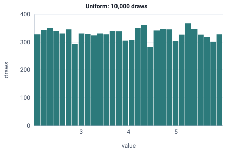

<!-- GENERATED by tools/gen_engine_docs.py -- do not edit by hand. -->
<!-- Regenerate with: python tools/gen_engine_docs.py -->

# Uniform

Any value between a minimum and a maximum is equally likely; use it when only the min and max are known.  
Params: low (min) =< high (max), both real numbers.

Category: continuous. Arrival: yes. Delay: yes. Support lower bound: 0.0. Can be fit from data as `Uniform` (see Input analysis).

## Parameters

| Parameter | Default | Hint |
|---|---|---|
| `low` | `0.0` | minimum, <= high |
| `high` | `1.0` | maximum, >= low |

## Draws

With low=2, high=6, 10,000 draws from a stream seeded 0:

| Mean (formula) | Mean of the draws | Variance of the draws |
|---|---|---|
| 4 | 4 | 1.34 |



## Example

In a model file, on any block or section that takes a duration:

```json
{"distribution": "Uniform", "dist_params": {"low": 2, "high": 6}}
```

In the Python builder:

```python
nb.Uniform(low=2, high=6)
```

An expression has its own call for it: `UNIF(low, high)`.

## Used in

Bundled models: [Delay, seize/release and signal HOLD](../../gallery/teaching.md), [Single server, general service times (M/G/1)](../../gallery/teaching.md).

## See also

- [All distributions](index.md), [Expression functions](../functions/index.md), [Model file format](../../model-file-format.md)
