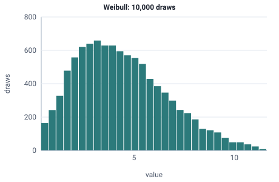

<!-- GENERATED by tools/gen_engine_docs.py -- do not edit by hand. -->
<!-- Regenerate with: python tools/gen_engine_docs.py -->

# Weibull

Equipment lifetimes and time to failure, where the breakdown rate can rise with age (wear-out) or fall (early failures).  
Params: scale (lambda) > 0, shape (k) > 0.

Category: continuous. Arrival: yes. Delay: yes. Support lower bound: 0.0. Can be fit from data as `Weibull` (see Input analysis).

## Parameters

| Parameter | Default | Hint |
|---|---|---|
| `scale` | `1.0` | lambda, > 0 |
| `shape` | `1.0` | k, > 0 |

## Draws

With scale=5, shape=2, 10,000 draws from a stream seeded 0:

| Mean (formula) | Mean of the draws | Variance of the draws |
|---|---|---|
| 4.43 | 4.41 | 5.33 |



## Example

In a model file, on any block or section that takes a duration:

```json
{"distribution": "Weibull", "dist_params": {"scale": 5, "shape": 2}}
```

In the Python builder:

```python
nb.Weibull(scale=5, shape=2)
```

## Used in

Guides: [How do I model a machine that wears out?](../../how-to/recipes/weibull-wear-out.md).

## See also

- [All distributions](index.md), [Expression functions](../functions/index.md), [Model file format](../../model-file-format.md)
