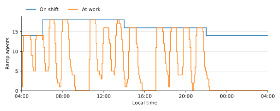
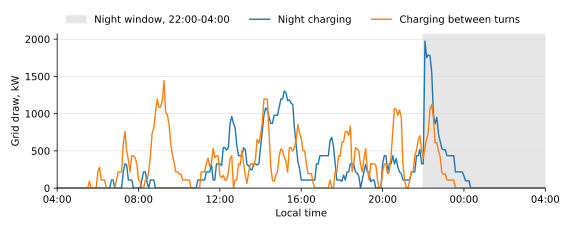

<!-- GENERATED by tools/gen_engine_docs.py -- do not edit by hand. -->
<!-- Regenerate with: python tools/gen_engine_docs.py -->

# Airport ground support

This page works through two decisions a ground handler at a hub faces: how many ramp agents and how much ground equipment a day's flight schedule needs, and whether that equipment can go electric and how it should charge. Both are answered with two of the [bundled models](../gallery/index.md), run flight by flight over one day. The hub, its schedule and every price are illustrative; the method is what carries over to a real one.

## The model

The hub day has 114 flights on 10 stands, arriving in banks. Each turnaround runs its cabin, hold, fuel, catering and ground power tasks in parallel; a task waits for its vehicle, which drives from the depot to the stand, and for a ramp agent on shift. As planned, a narrow-body turns in 56.7 minutes on average and a wide-body in 86, and 86.8 % of flights leave by their scheduled off-block time. The flights are read from a CSV file, so the same model runs tomorrow's schedule.

Every number below is from one run of each scenario at seed 0, as the models ask, made when this page was generated. One day is one sample: the numbers illustrate the method, they are not a forecast.

## Ramp agents and equipment

The first question is how much margin the plan has. The model's scenarios take ramp agents off every shift, or belt loaders off the fleet, and run the same flights:

| Scenario | On time % | Narrow-body turn, min | Wide-body turn, min |
|---|---|---|---|
| As planned | 86.8 | 56.7 | 86 |
| 2 fewer ramp agents per shift | 78.9 | 60.6 | 88.9 |
| 4 fewer ramp agents per shift | 49.1 | 68.3 | 95.8 |
| 6 belt loaders instead of 8 | 64.9 | 61.6 | 86.9 |

Two fewer agents per shift cost 7.9 points of on-time departures; four fewer cost 38, so the loss grows faster than the cut. Two fewer belt loaders cost 22 points, more than two fewer agents: the equipment has less slack than the crew. This is the use of a workload model: run tomorrow's schedule and see which crew or fleet runs short, and when.



The reason is the banks. Over the day the agents are busy 44.2 % of their time on shift, but at the peaks the line of agents at work meets the line on shift: at 69 of the 289 sampled instants (one every 5 minutes) every agent on shift is busy. An average says there is room; the day says there is none when it matters. Chart data: [airport-ramp-agents.csv](data/airport-ramp-agents.csv).

## Electric ground equipment

The second question is whether battery ground support equipment (GSE) keeps the schedule. The electric scenarios keep today's fleet sizes, except where they say so, and differ in when the vehicles charge: in the night window from 22:00 to 04:00, or whenever a vehicle is free and its battery is low. The fuel trucks stay diesel.

| Scenario | On time % | CO2 per day, t | Grid peak, kW | Extra capital, M EUR | Payback, years | 10-year NPV, M EUR |
|---|---|---|---|---|---|---|
| Diesel, today | 86.8 | 5.35 | 0 | 0 | baseline | baseline |
| Electric GSE, overnight charging | 78.9 | 3.21 | 2,150 | 3.89 | 2.2 | 8.1 |
| Electric GSE, opportunity charging | 85.1 | 3.22 | 1,480 | 3.89 | 2.1 | 8.3 |
| Electric GSE, opportunity charging, with spares | 95.6 | 3.15 | 1,340 | 4.46 | 4.6 | 2 |

Night charging alone costs 7.9 points of on-time departures at today's fleet size: outside the window a vehicle that runs low still has to charge, and is out of service while it does, which the chart below shows as daytime draw. Charging between turns comes within 1.8 points of diesel and cuts CO2 by 40 %. The spares lift on-time departures to 95.6 % for the capital in the table. Capital is the extra over the diesel fleet the hub owns, and the NPV is discounted at 8 %.



The two strategies draw about the same energy in very different shapes. Night charging plugs the fleet in when the window opens, which sets a grid peak of 2,150 kW; charging between turns follows the banks and peaks at 1,480 kW, which is also the smaller connection to pay for. The lines are sampled every 5 minutes; the peaks in the table are the run's exact ones. Chart data: [airport-grid-draw.csv](data/airport-grid-draw.csv).

## What the result rests on

The payback rests mostly on one assumption: the hourly cost of each vehicle, which the model takes from an illustrative catalogue. Electric equipment costs less an hour than diesel there (EUR per hour, electric against diesel: pushback tractor 60 against 70, belt loader 18 against 20, baggage tug 20 against 25, catering truck 30 against 35, ground power unit 12 against 15), and over a year of operation that difference is worth more than the energy saved. If an electric vehicle costs the same per hour as a diesel one, most of the saving goes, and what remains is the fuel, priced at 0.16 EUR per kWh of fuel, against the grid tariff, and the CO2. The investment case reports the saving as a whole, not by source: to test the assumption, set the hourly costs in a copy of the model to your own maintenance figures and run it again. The operational results, on-time departures and the grid peak, do not depend on any price.

## Repeat it

Each command runs a bundled model by name and prints the numbers above, at the command's default seed:

```console
naga scenarios turnaround_workload
naga scenarios gse_electrification
naga invest gse_electrification
```

`naga examples --path` prints the folder of the model files, to copy one and change its schedule, fleet or prices.
