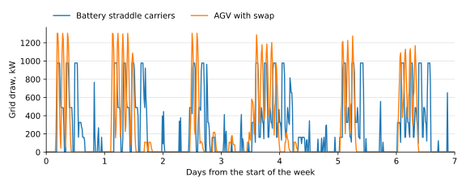

<!-- GENERATED by tools/gen_engine_docs.py -- do not edit by hand. -->
<!-- Regenerate with: python tools/gen_engine_docs.py -->

# Container terminal

This page works through two decisions a container terminal faces: whether to electrify the fleet that carries boxes between the quay and the yard, and how large a shore power connection at a berth should be. Both are answered with [bundled models](../gallery/index.md), run container by container and ship by ship. The terminal, its calls and every price are illustrative; the method is what carries over to a real one.

## The model

One berth with 3 quay cranes, 9 straddle carriers between the quay and two yard blocks with a crane each, and a truck gate, over a week of vessel calls. In that week the cranes make 8,200 moves for 6 calls, at 34.9 gross moves per crane-hour alongside (the moves over the cranes times the hours each call is worked), inside the 25 to 45 the industry publishes for a quay crane. The calls are read from a CSV file, so the same model runs next season's.

Every number below is from one run of each scenario at seed 0, as the models ask, made when this page was generated. One week is one sample: the numbers illustrate the method, they are not a forecast.

## Electrifying the carriers

Today's diesel straddle carriers are compared with battery straddle carriers that charge whenever they are free and low, and with automated guided vehicles (AGVs) that swap their battery packs:

| Scenario | Moves per crane-hour | CO2 per week, t | Energy cost per week, EUR | Grid peak, kW | Extra capital, M EUR | Payback, years | 10-year NPV, M EUR |
|---|---|---|---|---|---|---|---|
| Diesel straddle carriers, today | 34.9 | 49.4 | 29,500 | 0 | 0 | baseline | baseline |
| Battery straddle carriers | 33.3 | 13.2 | 10,700 | 978 | 4.38 | 7.5 | -0.45 |
| AGV with swap | 34.9 | 11.1 | 9,380 | 1,300 | 11 | 3.6 | 9.3 |

All three move the same 8,200 containers. The battery carriers work the ships at 33.3 moves per crane-hour against 34.9, so the ships stay alongside a little longer while carriers charge; the AGVs, swapping packs, keep up at 34.9. CO2 falls by 73 % with battery carriers and 78 % with AGVs. The battery case is marginal at the model's fuel price; the AGV case pays, for the reason in the next section. Energy cost includes the grid's demand charge; capital is the extra over the diesel fleet the terminal owns, and the NPV is discounted at 8 %.



Both fleets draw power in bursts while a ship is worked and little in between, so the connection is sized by the ships, not by the average. The AGVs peak at 1,300 kW against 978 kW for the battery carriers: the fleet that is cheaper to run needs the larger connection. The lines are sampled every 15 minutes; the peaks in the table are the run's exact ones. Chart data: [terminal-grid-draw.csv](data/terminal-grid-draw.csv).

## Shore power at a berth

A second model has a two-berth quay with 60 ship calls over 4 weeks. A ship that is ready for shore power, and stays long enough, takes its hotel load and reefers from the grid up to the connection's size; the rest comes from its own engines. Cost per call counts the ships' fuel, the grid energy and the grid's demand charge. The scenarios run the same calls with no connection, two sizes with most ships ready, and a connection sized for every ship ready:

| Scenario | CO2 at the berth, t | Fuel and grid cost per call, EUR | Grid peak, kW | Connection capital, M EUR | Payback, years | 15-year NPV, M EUR |
|---|---|---|---|---|---|---|
| No shore power | 729 | 4,400 | 0 | 0 | baseline | baseline |
| Shore power, 2 MW | 522 | 3,710 | 2,000 | 1.6 | 3 | 3 |
| Shore power, 6 MW | 478 | 3,910 | 4,720 | 4.8 | 13 | -1.5 |
| Shore power, every ship ready | 373 | 3,390 | 4,720 | 4 | 5 | 2.8 |

Two of the largest ships alongside draw 4,720 kW together, so a connection much above that buys capacity no ship uses, and the larger connection with the same ships ready pays back far later than the smaller one. The connection is worth sizing to the ships that will plug in, not to the berth.

## What the result rests on

The model is exact about what happens on the quay; each business case is only as good as the prices put into it. Three of them decide the cases above:

- **Battery carriers: the diesel price.** The model prices fuel at 0.16 EUR per kWh of fuel, about 1.6 EUR a litre. The saving is fuel against grid energy, so the payback moves with the fuel contract.
- **AGVs: the hourly cost.** The model costs an AGV at 45 EUR an hour against 85 for a driven diesel carrier and 90 for a battery one; most of the AGV saving is that difference, mainly labour. The yard works an AGV terminal needs are not in the case.
- **Shore power: who pays and who saves.** The case combines the port and the shipowners: the port pays for the connection, the ships save the fuel, priced at 0.25 EUR per kWh generated on board. The port's own return depends on the tariff that brings part of that saving back to it. The ships' retrofit and any grid reinforcement are not in the case.

The investment case reports each saving as a whole, not by source: to test an assumption, change it in a copy of the model and run the case again.

## Repeat it

Each command runs a bundled model by name and prints the numbers above, at the command's default seed. The electrification runs take some seconds each:

```console
naga run terminal_quay_to_yard
naga scenarios terminal_electrification
naga invest terminal_electrification
naga invest berth_shore_power
```

`naga examples --path` prints the folder of the model files, to copy one and change its fleet, calls or prices.
